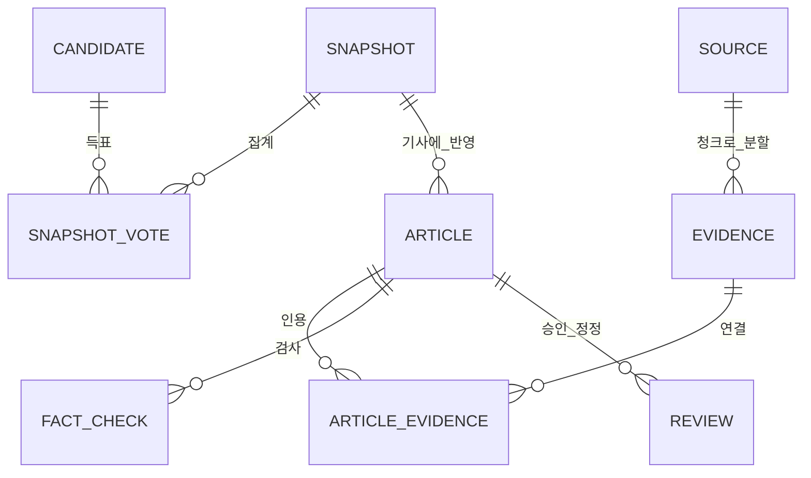

# 데이터 사전과 API 명세 초안

## 출처와 정제

1. 중앙선관위 공공데이터포털의 시·도지사선거 개표결과(15162288)에서 전국 공식 CSV를 내려받았다. 59,903개 데이터 행, 16개 시·도, UTF-8 BOM이다. 수집시각은 2026-11-20 12:43:33 KST다. 포털의 이용허락범위는 제한 없음이다.
2. 서울 25개 자치구의 8,361행을 개표 단위 929개로 묶고, 공식 5인 득표수와 총계를 2026년 6월 5일 최종 보도로 대조했다. 선두 2인과 60,259표 격차는 연합뉴스와 한겨레로 대조했다.
3. 득표수 합계 5,232,982표와 무효표 56,401표의 합이 투표수 5,289,383표인지 검증한다. 후보 ID는 프로젝트 내부 ID다.
4. 고정 시드로 공식 개표 단위의 보고 순서를 섞고, 30개 재생 배치로 묶는다. 각각의 후보 표, 무효표, 선거인수는 원본 값을 보존한다. 구분명이 공란인 특수 투표 항목은 원본 읍면동명 값을 투표유형으로 옮긴다. 잘못 투입·구분된 투표지의 음수 기권자수는 원본 집계 조정값으로 보존한다.
5. 원본은 `data/raw/nec_governors_20260603.csv`에서 원래 바이트로 보관한다. SHA-256은 `2a3325399391c379e6e40c0a5096379de75f612e0b290ea223b792f18d75a755`다. 서울 집계에서는 범주 누락·중복과 단위별 투표수·선거인수 합계를 검사한 뒤 서울 확정 총계와 대조한다.

| 필드 | 규격·의미 |
| --- | --- |
| event_id / sequence | 가상 스냅샷 고유 ID / 0~30 순번 |
| mode / timestamp_is_simulated | simulation / true |
| region / race / count_unit | 서울특별시 / 서울특별시장 / 공식 개표 단위의 가상 순서 |
| simulated_at | 모의 개표 기준시각, ISO 8601 +09:00 |
| delivered_at | 실제 서버 송신 시각, ISO 8601 +09:00. WebSocket에서만 추가 |
| registered_voters / total_ballots | 확정 선거인수 / 확정 투표수 |
| counted_ballots | 이 가상 단계까지 유효표와 무효표의 누적 합 |
| count_progress_pct | 시연용 진행률. 누적 개표 투표지 ÷ 최종 투표지 × 100 |
| final_turnout_pct | 전체 확정 투표지 ÷ 선거인수 × 100 |
| vote_share_pct | 후보 누적표 ÷ 유효표 누계 × 100. 유효표 0이면 null. 소수 둘째 자리 버림 |
| candidate_id / row_id | 프로젝트 후보 ID / 기사 수치의 근거 연결에 쓸 스냅샷별 행 ID |
| fact_source_id / schema_source_id | 공식 수치 및 스키마 출처 ID. verified_source_ids에 교차 확인 출처도 보존 |

시연 진행률은 투표지 기준으로 정의했다. 가상 시각은 6월 3일 20:00부터 6월 4일 03:30까지다. 실제 종료는 6월 5일로 보도됐다. 가상 일정과 실제 보도 날짜를 기사·화면·영상에서 함께 식별한다.

## 통신 명세

| 실행 서버 | 방식 | 주소 | 결과 |
| --- | --- | --- | --- |
| 선관위 역할 · 8001 | HTTP GET | /health | `election-source` 역할 확인 |
| 선관위 역할 · 8001 | WebSocket | /ws/feed | 연결마다 모의 개표를 0단계부터 순서대로 송신. `source_sent_at` 포함 |
| 방송사 역할 · 8000 | HTTP GET | / | 개표 대시보드 |
| 방송사 역할 · 8000 | HTTP GET | /health | `broadcast` 역할 확인 |
| 방송사 역할 · 8000 | HTTP GET | /api/final | 서울시장 확정 집계 요약 |
| 방송사 역할 · 8000 | WebSocket | /ws/replay | 선관위 역할 서버에 연결해 수신 순서를 확인한 뒤 `delivered_at`을 붙여 브라우저에 전송 |

브라우저마다 새 재생 연결을 연다. 기본적으로 2초마다 한 단계씩 송신하고, 마지막 단계에서 `complete=true`로 종료한다. 송신 서버에 연결하지 못하거나 완료 전에 전송이 끊기면 방송사 서버가 `event=error`와 `code=election_feed_unavailable`을 보낸다.

## ERD 초안

기사의 구조화된 문장별 근거는 스냅샷의 후보 행 또는 문서 청크에 연결한다. 출처 문서에는 URL·기관·게시일·수집일·문서 유형을 보존한다. SQL 스크립트와 기사·승인 API는 구현 단계에서 확정한다.

