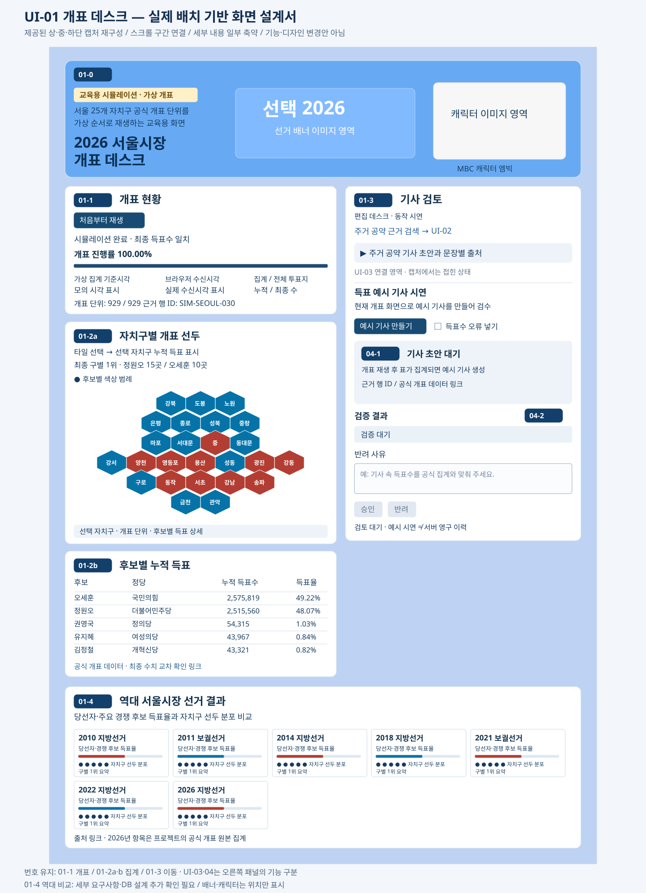
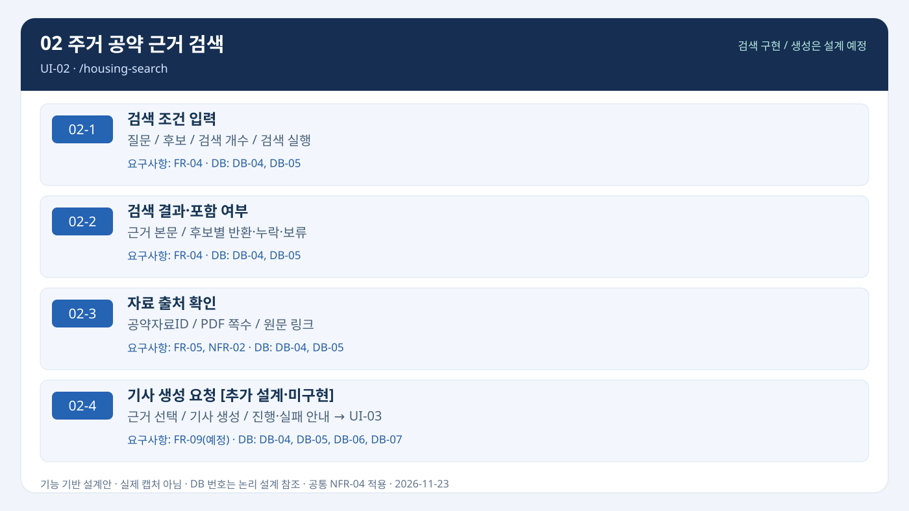
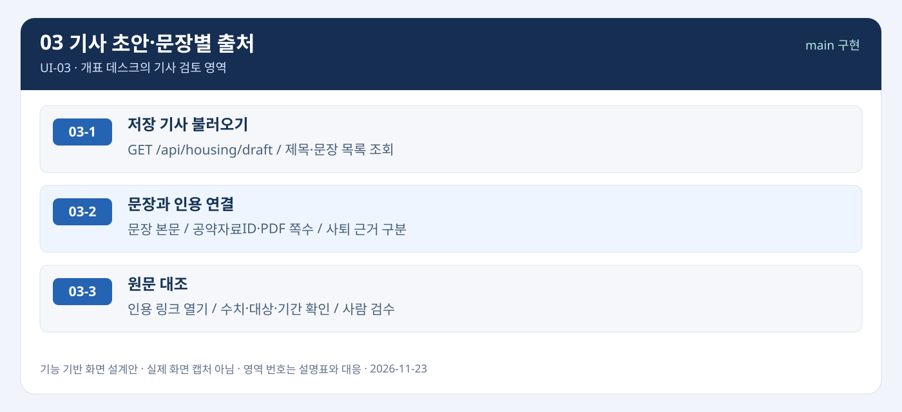
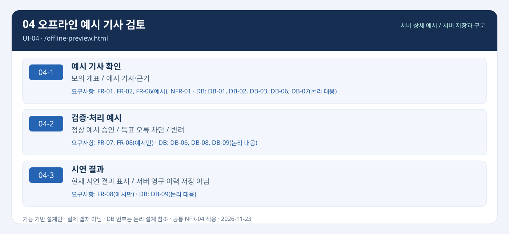
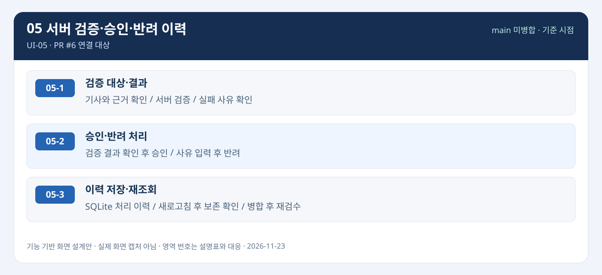
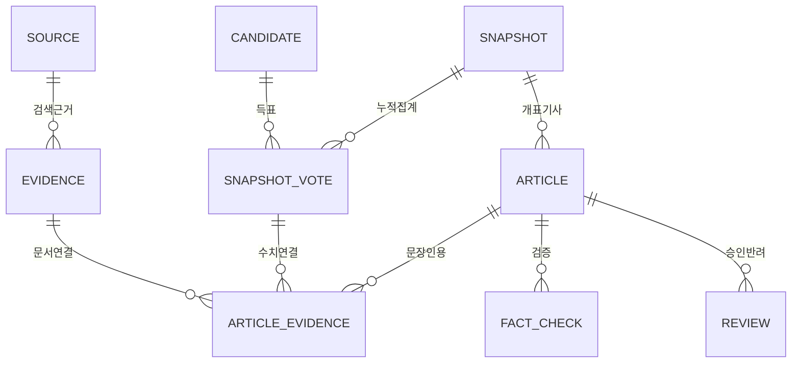
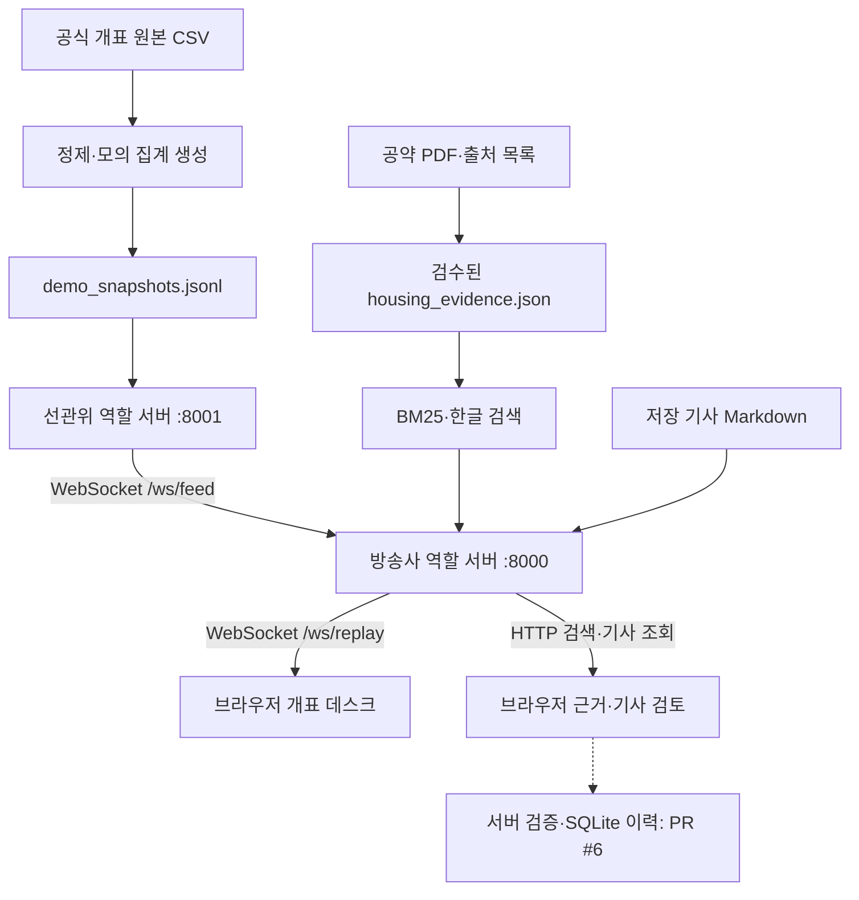

# 2026 서울시장 모의 개표·주거 공약 기사 시연

BTS-Trio의 교육용 데이터 저널리즘 프로젝트입니다. 공식 개표 데이터를 모의 순서로 재생하고, 후보별 주거 공약을 원문 근거와 함께 검색하여 기사 검토·승인으로 연결하는 과정을 실습합니다.

> 문서 기준: 2026-11-23 main의 코드·데이터 및 PR #6 상태 확인 시점. 공식 수치를 활용하지만 재생 시각과 집계 순서는 가상입니다. 실제 중앙선거관리위원회나 방송사의 운영 서버에 연결하는 서비스가 아닙니다.

## 목차

- [빠른 실행](#빠른-실행)
- [1. 기획서](#1-기획서)
- [2. 요구사항 정의서](#2-요구사항-정의서)
- [3. WBS](#3-wbs)
- [4. 화면 설계서](#4-화면-설계서)
- [5. ERD](#5-erd)
- [6. API 명세서](#6-api-명세서)
- [7. 시스템 아키텍처](#7-시스템-아키텍처)
- [8. 검수 및 관련 자료](#8-검수-및-관련-자료)

## 빠른 실행

[팀 통합본 ZIP](https://github.com/BTS-Trio/2026-Mayor-of-Seoul/archive/refs/heads/main.zip)을 내려받아 압축을 풉니다.

| 보고 싶은 기능 | 실행 방법 |
| --- | --- |
| 오프라인 개표·예시 기사 검토 | 최상위 [Seoul-Election-Desk.html](Seoul-Election-Desk.html)을 Chrome에서 엽니다. 예시 기사 승인·득표수 오류 차단·반려 시연입니다. |
| 두 서버를 이용한 개표 재생 | 아래 명령으로 서버 두 개를 실행하고 http://127.0.0.1:8000/ 에 접속합니다. |
| 공약 근거 검색 | 방송사 역할 서버 실행 후 http://127.0.0.1:8000/housing-search 에 접속합니다. |
| 저장된 주거 공약 기사 조회 | 방송사 역할 서버의 GET /api/housing/draft를 사용합니다. 새 기사를 자동 생성하는 API가 아닙니다. |

Windows PowerShell에서 저장소의 `demo` 폴더를 작업 위치로 사용합니다.

```powershell
python --version
python -m venv .venv
.\.venv\Scripts\python.exe -m pip install -r requirements.txt
```

터미널 1 — 선관위 역할 송신 서버:

```powershell
.\.venv\Scripts\python.exe -m uvicorn election_source:app --host 127.0.0.1 --port 8001
```

터미널 2 — 방송사 역할 수신 서버:

```powershell
.\.venv\Scripts\python.exe -m uvicorn app:app --host 127.0.0.1 --port 8000
```

브라우저에서 **처음부터 재생**을 누르면 기본 2초 간격으로 31개 상태가 전달됩니다. 약 60초 후 모의 집계가 완료됩니다. 각 터미널의 Ctrl+C로 종료합니다. Python 3.10 문법 호환을 목표로 작성했으며, 기존 검색 검증 기록의 실제 실행 환경은 Python 3.12.10입니다. 이 README 수정에서는 프로그램 테스트를 새로 실행하지 않았습니다.

## 1. 기획서

### 목적과 배경

과제 주제는 **RAG 모델 기반의 선거 보도 구성하기**입니다. 개표 숫자와 후보 공약의 원문을 함께 다루면서, 기사의 사실 문장이 어느 자료에서 나왔는지 추적하고 사람이 검수하는 과정을 구현합니다.

개표 수치는 기준 시각·지역·후보가 바뀌면 의미가 달라집니다. 공약은 공급·착공, 임기 내 목표·장기 목표 등을 혼동하기 쉽습니다. 따라서 데이터 재생과 출처 검색, 기사 검토를 연결하고 오류 및 근거 누락을 확인하는 것을 핵심 과제로 삼습니다.

### 목표와 범위

| 구분 | 내용 |
| --- | --- |
| 개표 질문 | 모의 개표 단계에 따라 후보 간 득표와 격차가 어떻게 달라지는가? |
| 공약 질문 | 2026년 서울시장 후보들은 주거 문제 해결을 위해 어떤 공약을 제시했나? |
| 데이터 범위 | 서울 25개 자치구의 공식 개표 단위 929개를 활용한 모의 집계 |
| 공약 자료 | 현재 검색 JSON 기준 PDF 자료 8개, 검색 근거 17개, 보류 0개, 후보 6명 |
| 기사 결과물 | 자료 ID와 PDF 쪽수가 연결된 저장 기사 초안 및 원문 대조 기록 |
| 영상 결과물 | 최근 제작 방향에 따른 10분 개표방송 영상. 제작·완료 여부는 별도 관리 |
| 제외 범위 | 실제 실시간 개표 수신, 당선 예측, 공약 실현 가능성 판정, 자동 게재 |

개표 데이터의 후보는 5명이며 공약 자료의 후보는 사퇴 후보를 포함한 6명입니다. 두 목록을 개수나 배열 순서로 대응시키지 않습니다. 공약자료ID, 검색 조각 ID, 후보 ID는 각각의 용도가 다릅니다.

### 기능 구현 상태

| 기능 | 현재 상태 |
| --- | --- |
| 모의 개표 전송·수신·대시보드 | main에 코드 있음 |
| 공약 근거 검색·PDF 출처 연결 | main에 코드·검색 자료 있음 |
| 저장 기사 초안과 문장별 출처 조회 | main의 /api/housing/draft에 구현 |
| 오프라인 예시 기사 승인·오류 차단·반려 | 독립 HTML 시연 기능 |
| 주거 공약 기사 서버 검증·SQLite 승인·반려 이력 | [PR #6](https://github.com/BTS-Trio/2026-Mayor-of-Seoul/pull/6)에서 검토 중, 확인 시점 main 미병합 |
| AI 기사 자동 생성 API·실제 외부 AI 판정 | main에 구현되지 않음. PR #6의 AI 판정도 시연용 값 |

검색은 BM25와 한글 2글자 검색을 사용합니다. 임베딩이나 외부 AI API를 호출하는 구현으로 설명하지 않습니다.

## 2. 요구사항 정의서

현재 상태는 코드 존재 여부를 뜻하며 최종 사용자 검수 완료를 뜻하지 않습니다.

| ID | 사용자 요구사항·기능 | 완료 기준 | 현재 상태 |
| --- | --- | --- | --- |
| FR-01 | 모의 개표 재생 | 0~30 순번 전달, 최종 complete=true | main 구현 |
| FR-02 | 후보·자치구 집계 확인 | 후보별 누적표·득표율과 자치구 집계를 표시 | main 구현 |
| FR-03 | 연결 실패 확인 | 송신 서버 장애 시 오류 코드·안내 전달 | main 구현 |
| FR-04 | 질문·후보로 공약 검색 | 관련 근거와 후보별 반환 여부 제공 | main 구현 |
| FR-05 | 원문 근거 확인 | 공약자료ID·PDF 쪽수·발췌·출처 링크 보존 | main 구현 |
| FR-06 | 기사 문장별 출처 확인 | 저장 초안 문장과 인용 링크 조회 | main 구현 |
| FR-07 | 잘못된 기사 승인 차단 | 검증 실패 시 서버에서 승인 거부 | PR #6 검토 중 |
| FR-08 | 승인·반려 기록 보존 | 사유·처리 이력 저장 및 재조회 | PR #6 검토 중 |
| FR-09 | 근거 기반 새 기사 생성 | 검색 근거와 문장별 인용을 갖춘 새 초안 반환 | 자동 생성 API 미구현 |
| NFR-01 | 실제·모의 데이터 구분 | simulation 및 가상 시각 표시 유지 | 코드·제출물 교차 검수 |
| NFR-02 | 출처·사퇴 상태 보존 | 자료 ID·쪽수·사퇴 근거를 원문과 대조 | 데이터·기사 검수 |
| NFR-03 | 실행 재현성 | 설치·실행·환경 변수 안내로 동일 데이터 재생 | 실행 안내 제공 |
| NFR-04 | 보도 책임·보안 | 사람 검수, AI 사용 표시, 비밀키·개인정보 제외 | 최종 제출 검수 |

## 3. WBS

기존 [작업 계획](demo/docs/project-plan.md)의 역할·일정을 바탕으로 정리했습니다. 날짜는 팀 확인용 계획이며, 실제 완료일로 간주하지 않습니다. 기존 계획의 약 20분 영상 대신 이번 정리에서는 최근 요청인 10분을 적용합니다.

| WBS | 작업 | 담당 | 선행 작업 | 계획 일정 | 산출물·확인 기준 |
| --- | --- | --- | --- | --- | --- |
| 1 | 주제·보도 질문·범위 확정 | 공동 | — | 11/20 | 기획·요구사항 |
| 2 | 공식 개표·후보·공약 자료 확보 | 윤 | 1 | 11/20~23 | 원본·자료목록·근거 ID |
| 3 | 데이터 정제·모의 집계 검수 | 윤 | 2 | 11/23 | CSV·JSONL·검수 기록 |
| 4 | 화면·메뉴 설계 | 흠 | 1 | 11/20~23 | 화면 기능·이동 흐름 |
| 5 | ERD·통신·시스템 설계 | 태 | 3, 4 | 11/20~23 | ERD·API·아키텍처 |
| 6 | 송신·수신 서버와 개표 화면 연결 | 태·흠 | 5 | 11/23~24 | 두 서버 개표 시연 |
| 7 | 공약 검색·기사 근거 연결 | 윤 | 2 | 11/23~25 | 검색 결과·기사·문장별 출처 |
| 8 | 서버 검증·승인·반려 이력 연결 | 태·흠 | 6, 7 | 11/24~25 | 검증·저장·재조회 |
| 9 | 교차 검수·사람 승인 | 공동 | 7, 8 | 11/25~26 | 정상·오류 사례 및 수정 기록 |
| 10 | 10분 방송 대본·CG·자막·편집 | 흠 중심·공동 검수 | 7, 9 | 11/24~26 | 영상·대본·출처표 |
| 11 | 통합 검사·발표·보고 | 공동 | 6~10 | 11/26~27 | README·시연·PPT·보고서 |

현재 진행 상태의 근거는 main 코드와 연결된 PR을 사용합니다. 과거 계획표의 일정만 보고 완료 표시하지 않습니다.

## 4. 화면 설계서

화면별 **01~05**, 주요 영역별 **01-1~05-3** 번호를 붙인 기능 구성도입니다. 실제 화면 캡처가 아닌 설계 이미지이며, 번호는 아래 설명표와 대응합니다. 코드의 기능·경로를 기준으로 작성했으며 실제 배치·색상·스크롤 영역을 확인한 자료는 아닙니다. PR 상태는 2026-11-23 문서 확인 시점 기준입니다.

### 01. 개표 데스크



| 영역 번호 | 구성 | 역할 |
| --- | --- | --- |
| 01-1 | 재생·연결 상태 | 처음부터 재생  /  연결 상태  /  교육용 모의 개표 표시 |
| 01-2 | 누적 개표 현황 | 개표 진행률  /  후보별 누적 득표  /  자치구 선택 |
| 01-3 | 관련 기능 이동 | 주거 공약 근거 검색  /  기사 검토·문장별 출처 확인 |

경로·대상: `UI-01 · /` · 상태: **main 구현**

### 02. 주거 공약 근거 검색



| 영역 번호 | 구성 | 역할 |
| --- | --- | --- |
| 02-1 | 검색 조건 입력 | 질문 입력  /  후보 선택  /  검색 개수  /  검색 실행 |
| 02-2 | 검색 결과·포함 여부 | 근거 본문·발췌  /  후보별 반환·누락·보류 상태 |
| 02-3 | 자료 출처 확인 | 공약자료ID  /  PDF 쪽수  /  저장 PDF·공식 출처 링크 |

경로·대상: `UI-02 · /housing-search` · 상태: **main 구현**

### 03. 기사 초안·문장별 출처



| 영역 번호 | 구성 | 역할 |
| --- | --- | --- |
| 03-1 | 저장 기사 불러오기 | GET /api/housing/draft  /  제목·문장 목록 조회 |
| 03-2 | 문장과 인용 연결 | 문장 본문  /  공약자료ID·PDF 쪽수  /  사퇴 근거 구분 |
| 03-3 | 원문 대조 | 인용 링크 열기  /  수치·대상·기간 확인  /  사람 검수 |

경로·대상: `UI-03 · 개표 데스크의 기사 검토 영역` · 상태: **main 구현**

### 04. 오프라인 예시 기사 검토



| 영역 번호 | 구성 | 역할 |
| --- | --- | --- |
| 04-1 | 예시 기사 확인 | 모의 개표 재생  /  예시 기사·근거 확인 |
| 04-2 | 검증·처리 시연 | 정상 예시 승인  /  득표수 오류 차단  /  사유 입력 후 반려 |
| 04-3 | 처리 결과 확인 | 현재 시연의 검토 결과 표시  /  서버 이력 저장과 구분 |

경로·대상: `UI-04 · Seoul-Election-Desk.html` · 상태: **독립 HTML 시연**

### 05. 서버 검증·승인·반려 이력



| 영역 번호 | 구성 | 역할 |
| --- | --- | --- |
| 05-1 | 검증 대상·결과 | 기사와 근거 확인  /  서버 검증  /  실패 사유 확인 |
| 05-2 | 승인·반려 처리 | 검증 결과 확인 후 승인  /  사유 입력 후 반려 |
| 05-3 | 이력 저장·재조회 | SQLite 처리 이력  /  새로고침 후 보존 확인  /  병합 후 재검수 |

경로·대상: `UI-05 · PR #6 연결 대상` · 상태: **main 미병합 · 기준 시점**

메뉴·이동 관계는 **개표 데스크 → 공약 검색**, **개표 데스크의 기사 검토 → 문장별 원문 출처**로 구성합니다. 서버 검증·이력 화면의 이동 경로는 PR #6 병합 후 해당 코드와 재대조합니다.

## 5. ERD

아래는 관계형 데이터베이스로 정리할 때의 **논리 설계**입니다. 현재 main의 개표·검색·기사는 CSV·JSONL·JSON·Markdown 파일로 저장합니다. 아래 테이블과 PK·FK·제약이 실제 DB에 생성됐다는 의미는 아닙니다.



| 논리 테이블 | 키·주요 필드 설계 | 현재 대응 파일·상태 |
| --- | --- | --- |
| CANDIDATE | candidate_id PK, name, party | demo/data/seoul_final_candidates.csv 및 스냅샷 candidates |
| SNAPSHOT | event_id PK, sequence, simulated_at, counted_ballots | demo/data/demo_snapshots.jsonl의 각 행 |
| SNAPSHOT_VOTE | row_id PK, event_id FK, candidate_id FK, votes, vote_share_pct | 스냅샷 각 행의 candidates 배열. 별도 테이블 아님 |
| SOURCE | source_id PK, 기관·URL·자료 유형·날짜 | demo/data/sources.csv, housing_evidence.json의 documents·상태 출처 |
| EVIDENCE | chunk_id PK, source_id FK, document_id, pdf_page, text | demo/data/rag/housing_evidence.json의 chunks |
| ARTICLE | article_id PK, snapshot_id 선택 FK, 제목·본문·상태 | demo/docs/housing-article-draft-20261123.md. 공약 기사에는 개표 스냅샷 연결이 필수 아님 |
| ARTICLE_EVIDENCE | 연결 ID PK, article_id FK, 문장 번호, chunk_id 또는 row_id FK | 초안의 인용 표기와 검수 문서. 구조화 테이블은 설계 |
| FACT_CHECK | 검사 ID PK, article_id FK, 결과·사유·시각 | 서버 구현은 PR #6과 별도 대조 필요 |
| REVIEW | 검토 ID PK, article_id FK, 승인·반려·사유·처리자·시각 | SQLite 이력 연결은 PR #6 검토 중. 실제 스키마는 병합 후 확인 |

설계 제약: SNAPSHOT_VOTE의 (event_id, candidate_id)는 유일하고 누적 득표는 0 이상입니다. 유효표가 0이면 득표율은 NULL입니다. ARTICLE_EVIDENCE는 문서 근거 또는 개표 수치 근거를 구분해 연결합니다. 파일상의 document_id와 후보 이름을 관계형 키로 옮기는 변환 규칙은 DB 구현 시 확정해야 합니다.

## 6. API 명세서

main의 [방송사 서버](demo/app.py), [송신 서버](demo/election_source.py), [검색 구현](demo/housing_search.py)을 기준으로 작성했습니다.

| 서버·포트 | 방식·경로 | 요청 | 응답·역할 |
| --- | --- | --- | --- |
| 송신 8001 | GET /health | 없음 | role=election-source, mode=simulation |
| 송신 8001 | WS /ws/feed | 연결 | 스냅샷에 source_sent_at을 추가해 순차 송신 |
| 방송사 8000 | GET /health | 없음 | role=broadcast, mode=simulation |
| 방송사 8000 | GET / | 없음 | 개표 데스크 HTML |
| 방송사 8000 | GET /api/final | 없음 | seoul_final_totals.json의 확정 집계 |
| 방송사 8000 | WS /ws/replay | 연결 | 순서를 검사한 스냅샷에 delivered_at을 추가해 전달 |
| 방송사 8000 | GET /housing-search | 없음 | 공약 검색 HTML |
| 방송사 8000 | GET /api/housing/status | 없음 | question, ready_chunks, pending_chunks, candidate_options 등 |
| 방송사 8000 | GET /api/housing/search | q, candidate 선택, limit=10 | query, results, coverage, retrieval_method, scope |
| 방송사 8000 | GET /api/housing/draft | 없음 | title, sentences 배열. 각 문장은 text와 citations(label, url) |

### 검색 요청·응답

- q: 앞뒤 공백 제거 후 2~500자.
- candidate: 등록된 후보명, 생략 가능.
- limit: 정수 1~30, 기본값 10.
- results: 공약자료ID(document_id), 검색 조각 ID(chunk_id), 후보, PDF 쪽수(pdf_page), 본문·발췌, 인용 표기, 출처 링크, 검색 점수.
- coverage: 요청 후보·반환 후보·누락 후보·보류 근거 및 전체 포함 여부. 결과가 없다고 해당 후보에게 공약이 없다고 판단하지 않습니다.

예: `GET /api/housing/search?q=월세%20지원&limit=10`

### 개표 메시지·오류

스냅샷의 주요 필드는 event=snapshot, event_id, sequence, mode=simulation, simulated_at, counted_ballots, count_progress_pct, candidates, complete입니다. candidates에는 candidate_id, row_id, name, votes, vote_share_pct가 있습니다.

| 조건 | 처리 |
| --- | --- |
| 마지막 스냅샷 | complete=true 전송 후 WebSocket 정상 종료(1000) |
| 송신 서버 장애·시간 초과·잘못된 순번 | event=error, code=election_feed_unavailable 전송 후 종료(1011) |
| 검색 질문·후보·개수 범위 오류 | HTTP 400, detail 안내 |
| limit 정수 변환 실패 | HTTP 422, FastAPI 요청 검증 오류 |
| 검색 자료 누락·형식 오류 또는 초안 형식 오류 | HTTP 503, detail 안내 |

기사 자동 생성·승인·반려 API는 main 구현 목록에 포함하지 않습니다. PR #6의 경로·요청·저장 규격은 병합 이후 확정된 코드로 명세를 보완합니다.

## 7. 시스템 아키텍처



- 두 역할 서버는 한 PC의 별도 프로세스로 실행할 수 있습니다. 방송사 서버가 브라우저와 송신 서버 사이를 중계합니다.
- 브라우저 연결마다 모의 재생을 새로 시작합니다. 실제 다수 사용자에게 동일 실시간 집계를 배포하는 운영 구조와 다릅니다.
- 송신 주소는 ELECTION_FEED_URL로 바꿀 수 있으며 기본값은 ws://127.0.0.1:8001/ws/feed입니다.
- 공약 검색은 방송사 프로세스 내부에서 수행하므로 송신 서버가 꺼져 있어도 사용할 수 있습니다.
- 검색 JSON은 프로세스 안에 캐시됩니다. 자료 변경 후 방송사 서버 재시작이 필요하며 Google Sheets와 자동 동기화되지 않습니다.
- 독립 HTML은 오프라인 실행 경로입니다. 두 서버 통신 및 서버 이력 저장과 구분합니다.
- main의 이 실행 구조에는 Supabase·Render 배포 연결이 포함되어 있지 않습니다.

## 8. 검수 및 관련 자료

### 제출 전 확인

- [ ] 공식 원문과 후보명·수치·단위·대상·기간·PDF 쪽수를 대조한다.
- [ ] 개표 후보 5명과 공약 자료 후보 6명의 차이 및 사퇴 표시를 유지한다.
- [ ] 모든 사실 문장에 근거를 연결하고 AI 작성 사실과 사람 검수 여부를 표시한다.
- [ ] 실제 수치와 가상 시각·순서·진행률을 화면·기사·영상에서 구분한다.
- [ ] 정상 흐름과 오류 차단·반려 흐름을 확인하고 미병합 기능을 완료로 표시하지 않는다.
- [ ] YouTube 영상·방송 이미지·캐릭터·음악의 사용 허락과 이용 조건을 확인한다. 온라인 공개가 자유 이용을 의미하지 않는다.
- [ ] AI 합성 영상·음성 표시, 정치적 편향·당선 예측 표현, 개인정보·비밀키 노출을 점검한다.

`demo` 폴더에서 기존 자동 검사를 실행할 수 있습니다.

```powershell
.\.venv\Scripts\python.exe -m pip install -r requirements-dev.txt
.\.venv\Scripts\python.exe -m unittest test_housing_search -v
.\.venv\Scripts\python.exe -m unittest test_two_servers -v
```

기존 [Windows 통합 자동 테스트 기록](https://github.com/BTS-Trio/2026-Mayor-of-Seoul/actions/runs/45110068758)은 해당 커밋의 검사 결과입니다. 모든 후속 변경이나 실제 화면의 최종 검수를 보장하지 않습니다.

### 원본 문서·근거

- [상세 실행 안내와 데이터 목록](demo/README.md)
- [기존 작업 계획·역할·일정](demo/docs/project-plan.md)
- [데이터 사전·통신 명세·ERD 초안](demo/docs/data-and-api.md)
- [주거 공약 검색·출처·검수 기준](demo/docs/housing-search.md)
- [인용 기사 초안](demo/docs/housing-article-draft-20261123.md)
- [문장별 원문 대조·사퇴 출처·수정 기록](demo/docs/housing-article-review-20261123.md)
- [검색 자료 JSON](demo/data/rag/housing_evidence.json)
- [통합 PR #3](https://github.com/BTS-Trio/2026-Mayor-of-Seoul/pull/3)
- [서버 검증·승인 이력 연결 PR #6](https://github.com/BTS-Trio/2026-Mayor-of-Seoul/pull/6)

기존 demo/README.md의 일부 설명(검색 근거 16개·정원오 쪽수 대기, 기사 관련 후속 작업 표기)은 최신 코드·검색 자료와 차이가 있습니다. 현재 검색 자료는 17개·보류 0개이며, 저장 기사 조회 API가 있습니다. 최신 상태는 이 README와 해당 코드·JSON을 함께 확인합니다.
