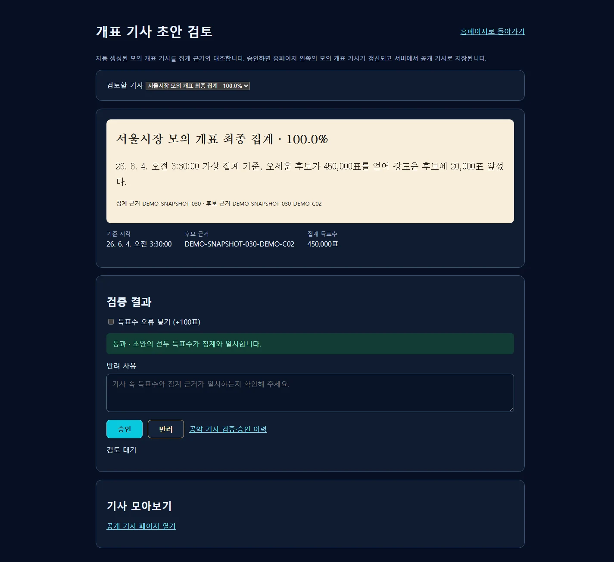
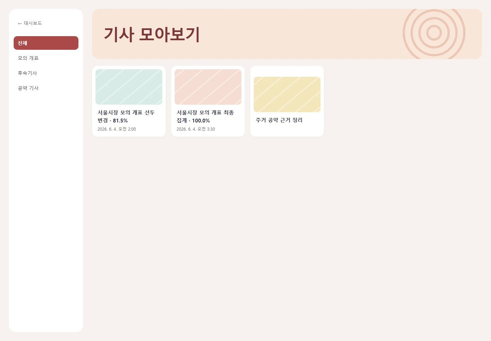
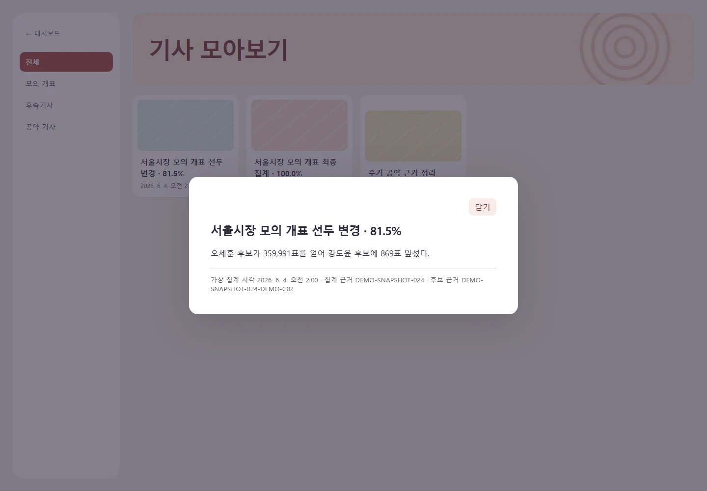
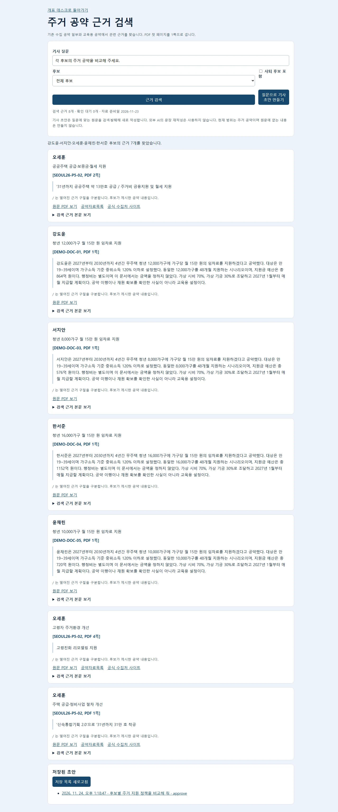
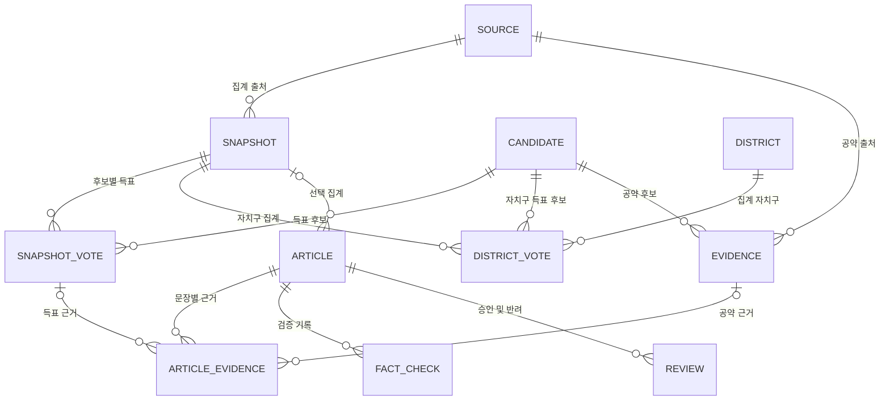
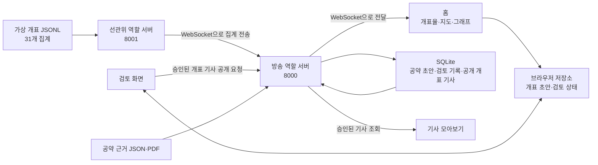

# 서울시장 모의 개표와 공약 기사 시연

서울시장 선거 방송을 가정해 **개표 수치가 바뀌고 → 화면이 갱신되고 → 기사 초안이 만들어지고 → 사람이 검토한 뒤 공개되는 과정**을 보여주는 교육용 프로젝트입니다. 현재 개표 수치·순위·당선 결과는 모두 가상입니다. 오세훈 후보의 주거 공약 일부는 기존 수집 자료를 쓰고, 나머지 공약은 교육용 가상 자료를 사용합니다.

구현 기준은 [PR #7](https://github.com/BTS-Trio/2026-Mayor-of-Seoul/pull/7)입니다. 화면 이미지는 이 브랜치를 로컬 서버에서 실행하고 Chrome에서 직접 캡처했습니다.

## 목차

- [1. 기획서](#1-기획서)
- [2. 요구사항 정의서](#2-요구사항-정의서)
- [3. WBS](#3-wbs)
- [4. 화면 설계서](#4-화면-설계서)
- [5. ERD](#5-erd)
- [6. API 명세서](#6-api-명세서)
- [7. 시스템 아키텍처](#7-시스템-아키텍처)
- [8. 구현 결과](#8-구현-결과)
- [9. 테스트 결과서](#9-테스트-결과서)
- [10. 사용자 매뉴얼](#10-사용자-매뉴얼)

## 1. 기획서

### 프로젝트 목적·배경·목표

| 항목 | 설명 |
| --- | --- |
| 목적 | 개표 방송 화면과 기사 편집 화면을 한 프로젝트에서 시연합니다. |
| 배경 | 개표 수치가 바뀌어도 시청자는 현재 상황을 쉽게 이해해야 하고, 기사를 쓰는 사람은 숫자와 출처를 다시 확인할 수 있어야 합니다. |
| 목표 | 가상 데이터를 재생하는 동안 개표 현황을 보여주고, 기사 초안을 만들고, 검토자가 승인한 기사를 독자가 읽을 수 있게 합니다. |
| 대상 | 시연을 보는 사람, 개표·공약 기사를 검토하는 팀원, 프로젝트를 실행하는 발표자 |
| 데이터 범위 | 서울 25개 자치구, 개표 31단계, 후보 6명 중 집계 5명과 사퇴 1명, 주거 공약 자료 |
| 시연 범위 | 로컬에서 실행하는 교육용 서비스입니다. 실제 개표 수집, 당선 예측, 팀원 권한 관리, 운영 배포는 이번 구현 범위 밖입니다. |

### 기능 정의 요약

| 기능 | 할 수 있는 일 |
| --- | --- |
| 모의 개표 보기 | 전체 개표율, 상위 후보, 자치구별 선두와 득표율 추이를 봅니다. |
| 개표 기사 만들기 | 집계가 특정 시점에 도달하면 근거가 붙은 초안이 생기고 속보 옆에 건수가 뜹니다. |
| 초안 검토 | 숫자와 출처를 확인한 다음 승인하거나 반려합니다. |
| 공약 검색·기사 작성 | 주거 공약을 질문으로 검색하고 PDF 근거가 붙은 기사 초안을 만듭니다. |
| 기사 모아보기 | 승인된 모의 개표·후속·공약 기사를 카드에서 골라 읽습니다. |

## 2. 요구사항 정의서

### 사용자별 요구

| 사용자 | 필요한 일 |
| --- | --- |
| 시청자 | 현재 개표율과 후보별 득표 현황을 빠르게 보고, 관심 자치구의 선두를 확인하고 싶습니다. |
| 편집자 | 개표가 진행되는 동안 중요한 시점의 초안을 받고, 기사에 쓰인 숫자와 자료를 대조하고 싶습니다. |
| 검토자 | 정확한 기사를 승인하고 오류가 있는 기사는 이유를 남겨 반려하고 싶습니다. |
| 독자 | 홈에서 교체된 예전 기사도 다시 읽고, 팀원에게 특정 기사 주소를 보내고 싶습니다. |
| 발표자 | 같은 시나리오를 다시 재생하고, 연결이 끊겼을 때 어떤 서버를 확인해야 하는지 알고 싶습니다. |

### 기능 요구사항과 확인 기준

| ID | 기능 | 언제·어떻게 동작하나요? | 완료 확인 기준 |
| --- | --- | --- | --- |
| FR-01 | 모의 개표 재생 | 홈페이지에 접속하면 방송 서버가 WebSocket을 연결합니다. 송신 서버가 0번부터 30번까지 집계 데이터를 순서대로 보냅니다. **개표 다시 재생**을 누르면 처음부터 시작합니다. | 첫 집계부터 100%까지 진행하고 최종 집계가 오면 연결이 정상 종료됩니다. |
| FR-02 | 상단 개표 현황 | 새 집계가 도착할 때마다 전체 개표율, 득표순 상위 두 후보, 득표율, 득표수, 게이지를 함께 바꿉니다. | 후보 순위가 바뀌면 카드 순서도 바뀌고 숫자는 같은 집계와 일치합니다. |
| FR-03 | 서울 자치구 지도 | 각 구에서 득표수가 가장 많은 후보의 색으로 구를 표시합니다. 집계 전이나 공동 선두인 경우 구의 선두 색을 정하지 않습니다. 구를 선택하면 구 이름과 집계 정보가 표시됩니다. | 25개 구가 표시되고, 마우스나 키보드로 구를 선택할 수 있습니다. |
| FR-04 | 득표율 그래프 | 받은 집계를 시간 순으로 쌓아 후보 5명의 득표율을 선으로 표시합니다. 재생을 다시 시작하면 이전 그래프 점을 지웁니다. | 집계가 추가되면 그래프가 이어지고 마지막 점은 최종 집계와 일치합니다. |
| FR-05 | 자동 초안 생성 | 개표율 **10%, 20%, …, 90%**를 처음 넘거나 도달할 때, 선두가 바뀔 때, 최종 집계가 도착할 때 초안을 만듭니다. 100%는 최종 집계 기사로 처리합니다. | 이 시나리오에서 10% 단위 9건, 선두 변경 1건, 최종 집계 1건이 생성됩니다. 같은 집계·생성 이유를 재생해도 초안이 중복되지 않습니다. |
| FR-06 | 알림과 출처 | 새 초안 건수를 **속보** 옆에 표시합니다. 초안에는 가상 집계 시각, 후보 득표수, 집계 행 ID와 후보 행 ID를 표시합니다. | 새 초안이 생기면 건수가 늘고, 상단 알림이나 하단 **초안 검토**에서 검토 화면을 열 수 있습니다. |
| FR-07 | 개표 기사 검증 | 기사와 원래 집계의 득표수를 비교합니다. 오류 시연을 위해 기사 숫자에 100표를 더하면 승인을 막습니다. | 오류 스위치를 켜면 승인 버튼이 잠기고, 끄면 다시 승인할 수 있습니다. |
| FR-08 | 개표 기사 승인·반려 | 승인하면 홈 왼쪽 기사가 최신 승인 기사로 바뀝니다. 서버 실행 중에는 승인 기사가 공개 목록에도 들어갑니다. 반려는 사유를 입력해야 합니다. | 반려 기사는 공개 목록에서 제외되고, 앞서 승인한 기사는 새 기사로 교체된 뒤에도 목록에서 열립니다. |
| FR-09 | 기사 모아보기 | 모의 개표·후속·공약 분류를 선택하면 해당 기사 카드가 보입니다. 카드를 누르면 본문이 작은 창으로 열리고 주소에 기사 ID가 들어갑니다. | 같은 서버 주소에 접속하는 다른 브라우저에서 공유 주소로 승인 기사를 읽을 수 있습니다. |
| FR-10 | 주거 공약 검색 | 질문이나 후보로 근거를 검색합니다. 사퇴 후보 포함 여부를 선택하며 결과에서 문서 ID, PDF 쪽수, 인용 근거를 확인합니다. | 관련 근거가 없으면 결과 부족을 안내합니다. 사퇴 후보는 기본 설정에서 제외됩니다. |
| FR-11 | 공약 초안 생성·저장 | 질문에 관련된 공약 원문을 골라 초안과 문장별 출처를 구성합니다. 검색한 원문을 활용하는 방식으로 별도 AI API 키가 필요하지 않습니다. | 질문이 바뀌면 선택 근거도 바뀝니다. 초안은 새로고침 후 저장 목록에서 다시 열 수 있습니다. |
| FR-12 | 공약 초안 검토 | 후보·수치·출처·쪽수와 질문에 필요한 비교 범위를 확인합니다. 근거가 빠지거나 다른 내용을 인용한 경우 승인을 막습니다. | 승인·반려 결과와 검토 이력을 서버에서 다시 조회할 수 있습니다. 승인된 공약 기사는 공개 목록에 표시됩니다. |
| FR-13 | 데이터 연결 오류 | 송신 서버가 멈추거나 집계가 순서대로 오지 않으면 방송 서버가 오류를 보냅니다. | 화면에서 연결 실패를 확인하고, 송신 서버를 복구한 뒤 **개표 다시 재생**으로 복구할 수 있습니다. |

### 데이터·화면 품질 요구사항

| ID | 기준 | 확인 방법 |
| --- | --- | --- |
| NFR-01 | 가상 개표임을 알 수 있어야 합니다. | 홈과 기사 페이지에서 교육용·모의 개표 표시를 확인합니다. |
| NFR-02 | 기사에서 원본 집계를 찾을 수 있어야 합니다. | 집계 ID, 후보 행 ID 또는 공약 PDF 출처를 해당 원본과 대조합니다. |
| NFR-03 | 공개 기사와 검토 중 기사를 구분합니다. | 공개 목록에 승인된 기사만 나오는지 다른 브라우저에서 확인합니다. |
| NFR-04 | 모바일에서도 기사 카드와 본문을 읽을 수 있어야 합니다. | 좁은 화면에서 목록·팝업이 화면 폭을 넘지 않는지 확인합니다. |
| NFR-05 | 저장 위치가 분명해야 합니다. | 개표 초안과 검토 상태는 브라우저에, 공개 개표 기사와 공약 초안·검토 이력은 서버 SQLite에 저장되는지 확인합니다. |

## 3. WBS

WBS는 일을 작은 단위로 나눠 담당과 순서를 정리한 표입니다. 아래 이름과 날짜는 기존 팀 계획 기준이며, 날짜는 계획 일정입니다. 완료 여부는 코드와 검증 결과로 구분했습니다. [기존 작업 계획](demo/docs/project-plan.md)

| 순서 | 작업 | 담당 | 선행 작업 | 계획 일정 | 산출물·상태 |
| --- | --- | --- | --- | --- | --- |
| 1 | 주제와 보도 범위 정하기 | 공동 | — | 11/20 | 기획·요구사항 정리 |
| 2 | 후보·공약 자료 정리 | 윤 | 1 | 11/20~23 | 후보 자료, PDF와 출처 목록 구현 |
| 3 | 가상 개표 데이터 만들고 대조 | 윤 | 2 | 11/23 | CSV·JSONL과 합계 검사 구현 |
| 4 | 화면과 메뉴 설계 | 흠 | 1 | 11/20~23 | 홈·검토·공개 기사 화면 구현 |
| 5 | DB와 서버 연결 설계 | 태 | 3, 4 | 11/20~23 | ERD·API·두 서버 구조 구현 |
| 6 | 송신·수신 서버와 개표 화면 연결 | 태·흠 | 5 | 11/23~24 | 지도·그래프와 재생 시연 확인 |
| 7 | 공약 검색과 기사 근거 연결 | 윤 | 2 | 11/23~25 | 검색·초안 생성·PDF 인용 구현 |
| 8 | 기사 검토·승인·반려 연결 | 태·흠 | 6, 7 | 11/24~25 | 검토 화면·저장·공개 목록 구현 |
| 9 | 화면과 데이터 교차 검수 | 공동 | 7, 8 | 11/25~26 | 핵심 흐름 검증, 팀 최종 교차 검수 일정 별도 |
| 10 | 10분 방송 영상·대본·자막 준비 | 흠 중심·공동 검수 | 7, 9 | 11/24~26 | 영상 작업 계획, 이 PR에서 완료 여부 미확인 |
| 11 | 통합 발표·제출 | 공동 | 6~10 | 11/26~27 | README·실행 화면 제공, 최종 제출 별도 |

## 4. 화면 설계서

| 화면 | 주소 | 보는 것과 할 수 있는 일 |
| --- | --- | --- |
| 모의 개표 홈 | `/` | 위쪽에서 개표율과 속보, 가운데에서 지도와 그래프, 아래쪽에서 최신 승인 기사와 **초안 검토**를 봅니다. |
| 개표 상세 | `/offline-preview.html` | 기존 개표 재생, 집계 단위, 자치구 상세 수치와 예시 기사를 확인합니다. 서버 접속 시 기존 상세 화면을 제공하는 주소입니다. |
| 개표 초안 검토 | `/vote-review.html` | 검토할 초안 선택 → 본문·집계 근거 확인 → 승인 또는 반려 순서로 진행합니다. |
| 기사 모아보기 | `/articles` | 왼쪽에서 분류를 골라 제목 카드를 보고, 카드를 누르면 본문을 읽습니다. |
| 주거 공약 검색 | `/housing-search` | 질문·후보 입력, 문서 검색, 인용과 초안 생성, 저장 기사 목록을 이용합니다. |
| 공약 기사 검토 | `/housing-review` | 공약 초안의 출처를 검증하고 승인·반려와 이력을 확인합니다. |

### 실제 실행 화면

**① 모의 개표 홈** — 위에서 개표율과 새 초안 알림을 확인하고, 아래 **초안 검토**로 이동합니다.


**② 개표 초안 검토** — 초안마다 본문과 집계 근거를 비교할 수 있고, 오류 시연과 승인·반려 버튼을 아래에서 사용합니다.



**③ 기사 모아보기** — 승인된 개표·후속·공약 기사 카드를 종류별로 확인합니다.



<details>
<summary>기사 본문과 공약 검색 화면 더 보기</summary>

**기사 본문** — 카드를 누르면 제목·내용·집계 근거를 읽을 수 있습니다.



**공약 검색** — 질문을 입력해 근거와 저장한 기사를 확인합니다.



</details>

## 5. ERD

ERD는 데이터 표 사이의 관계를 그린 그림입니다. 예를 들어 집계 한 건은 여러 후보의 득표 행을 갖고, 기사의 한 문장은 공약 근거나 득표 행 하나를 가리킵니다.



| 표 | 저장 내용과 연결 기준 |
| --- | --- |
| `CANDIDATE`, `SOURCE` | 후보 ID와 상태, 출처 ID와 자료 경로를 보관합니다. |
| `SNAPSHOT`, `SNAPSHOT_VOTE` | 집계 ID별 개표 시각·투표지 수와 후보별 득표를 보관합니다. 한 집계와 후보의 조합은 한 번만 기록합니다. |
| `DISTRICT`, `DISTRICT_VOTE` | 구 ID·이름과 집계·구·후보 조합별 득표수를 보관합니다. |
| `EVIDENCE`, `ARTICLE_EVIDENCE` | PDF 쪽수·원문 인용과 기사 문장이 가리키는 근거를 보관합니다. 문장별 연결에는 공약 근거 또는 득표 행 중 하나를 씁니다. |
| `ARTICLE`, `FACT_CHECK`, `REVIEW` | 기사 제목·본문, 검증 결과와 승인·반려 이력을 보관합니다. |
| `drafts`, `audit` | 공약 초안 원본과 생성·검증·처리 로그를 보관하는 실행용 표입니다. |
| `published_vote_articles` | 공개 개표 기사 ID·본문 데이터·공개 시각을 보관하는 실행용 표입니다. 기사 ID가 같은 요청은 중복 저장되지 않습니다. |

기본 키(PK)는 표에서 한 행을 구분하는 ID이고, 외래 키(FK)는 다른 표의 ID를 참조하는 값입니다. `drafts`, `audit`, `published_vote_articles`는 실행 시 별도로 생성됩니다. 개표 초안의 선택·검토 상태는 브라우저 저장소에 남으며, 위 공개 기사 표에는 승인되어 공개한 본문이 들어갑니다. [SQL 정의](demo/schema.sql) · [데이터 적재 코드](demo/table_data.py)

## 6. API 명세서

API는 화면과 서버가 데이터를 주고받는 약속입니다. `GET`은 조회, `POST`는 새로 만들거나 처리할 때 사용합니다. WebSocket은 서버가 연결을 유지하면서 다음 개표 집계를 바로 보내는 방식입니다.

| 연결 | 주소 | 보내는 값 | 받는 값 또는 실패 처리 |
| --- | --- | --- | --- |
| WebSocket | 송신 서버 `/ws/feed` | 연결 요청 | 0~30번 집계와 `source_sent_at`. 마지막 집계 후 종료 |
| WebSocket | 방송 서버 `/ws/replay` | 연결 요청 | 같은 집계에 `delivered_at` 추가. 송신 끊김 또는 순서 오류 시 `election_feed_unavailable` 오류 |
| GET | 두 서버 `/health` | — | 서버 역할과 가상 데이터 모드 확인 |
| GET | `/api/candidates`, `/api/final` | — | 후보 목록과 모의 개표 최종 집계 |
| GET | `/api/housing/status` | — | 공약 검색 자료 상태 |
| GET | `/api/housing/search` | `q`, `candidate`, `limit`, `include_withdrawn` | 공약 근거 검색 결과와 후보 범위. 잘못된 검색 조건은 400 |
| GET | `/api/housing/draft` | — | 저장된 예시 기사와 문장별 출처. 근거 데이터 연결 실패 시 503 |
| GET | `/sources/{filename}` | 파일명 | 허용된 근거 PDF. 등록되지 않은 파일은 404 |
| POST | `/api/housing/generate` | `question`, 선택적으로 `candidate`, `include_withdrawn` | 201과 저장된 공약 초안·검증 결과. 근거가 부족하면 422 |
| POST | `/api/housing-review/drafts` | `scenario` | 검증 시연용 예시 초안 생성 |
| GET | `/api/housing-review/drafts`, `/api/housing-review/drafts/{draft_id}` | 목록 또는 초안 ID | 저장된 초안 목록 또는 본문·검증 결과 |
| POST | `/api/housing-review/drafts/{draft_id}/decision` | `action`의 값은 `approve` 또는 `reject`, 그 외 `reviewer`, 반려 시 `reason` | 승인·반려 저장. 사유 부족은 422, 이미 처리됐거나 승인할 수 없으면 409 |
| GET | `/api/housing-review/history` | — | 공약 기사 검토 기록 |
| POST | `/api/articles/vote` | `event_id`, `reason`, `votes` | 근거와 대조해 승인 개표 기사 저장. 불일치 시 422 |
| GET | `/api/articles` | — | 공개된 개표·후속 기사 `vote`와 공약 기사 `housing` 목록 |

집계 메시지의 `sequence`는 순서 번호, `simulated_at`은 가상 집계 시각, `count_progress_pct`는 개표율입니다. `candidates`에 후보별 득표가, `districts`에 자치구별 득표가 들어갑니다. `complete`가 참이면 최종 집계입니다. 실행 중인 방송 서버의 [API 화면](http://127.0.0.1:8000/docs)에서도 HTTP 요청과 입력 항목을 확인할 수 있습니다. [데이터·API 참고 문서](demo/docs/data-and-api.md)

### 예시 요청과 응답

최종 개표 기사를 승인하면 화면은 아래 데이터를 `POST /api/articles/vote`로 보냅니다.

```json
{"event_id":"DEMO-SNAPSHOT-030","reason":"최종 집계","votes":450000}
```

서버는 30번 집계의 선두 득표수가 450,000표인지 확인합니다. 맞으면 `200`과 함께 기사 ID를 돌려줍니다. 예를 들어 450,100표를 보내면 `422`가 오고 기사는 저장되지 않습니다.

```json
{"id":"feed:DEMO-SNAPSHOT-030:최종 집계"}
```

## 7. 시스템 아키텍처

아키텍처는 전체 서비스가 어떤 프로그램으로 나뉘고 서로 어떻게 연결되는지 보여줍니다.



송신 서버는 저장된 집계를 순서대로 보내고, 방송 서버는 연결 상태를 점검해 화면에 전달합니다. 개표 초안은 화면에서 집계 내용으로 생성됩니다. 공개 요청이 오면 방송 서버가 원본 집계의 득표수와 다시 대조합니다. 공약 초안의 검색·생성·검증은 방송 서버가 처리합니다.

## 8. 구현 결과

### 소스코드

| 파일 | 역할 |
| --- | --- |
| [election_source.py](demo/election_source.py) | 개표 JSONL을 차례로 송신 |
| [app.py](demo/app.py) | 화면·HTTP API 제공, 모의 집계 연결과 전달 |
| [index.html](demo/index.html) · [dashboard-feed.js](demo/dashboard-feed.js) | 홈, 지도·그래프, 개표 재생과 초안 생성 시점 |
| [vote-drafts.js](demo/vote-drafts.js) · [vote-review.html](demo/vote-review.html) | 개표 초안 저장, 확인, 승인·반려 |
| [housing_search.py](demo/housing_search.py) · [article_generation.py](demo/article_generation.py) | 주거 공약 원문 검색과 문장별 근거가 붙은 기사 구성 |
| [housing_review.py](demo/housing_review.py) · [article_validation.py](demo/article_validation.py) | 공약 기사 검증과 서버 저장, 승인·반려 이력 |
| [articles.html](demo/articles.html) · [article_archive.py](demo/article_archive.py) | 공개 기사 카드·본문과 조회·저장 API |

### DB 스크립트와 데이터

- [schema.sql](demo/schema.sql)의 `CREATE TABLE` 구문이 표와 연결 규칙을 만듭니다.
- [table_data.py](demo/table_data.py)가 [CSV 초기 데이터](demo/data/tables/manifest.json)를 순서대로 읽고 `INSERT INTO`로 넣습니다. 서버는 첫 저장 작업에서 초기화하며 이미 적재된 후보가 있으면 초기 데이터를 다시 넣지 않습니다.
- 검토 이력과 공개 기사 표는 서버 요청으로 채웁니다. 승인·반려 기록을 초기 데이터로 미리 만들어 넣지 않습니다.
- 데이터 적재만 확인하려면 `demo` 폴더에서 `python table_data.py`를 실행합니다. 메모리 DB에 적재하고 표별 행 수를 출력합니다. 기본 서버 DB 경로는 `demo/housing-review-demo-v2.sqlite3`이며 `HOUSING_REVIEW_DB`로 바꿀 수 있습니다.

### GitHub 저장소와 협업 기록

조직 저장소는 [BTS-Trio/2026-Mayor-of-Seoul](https://github.com/BTS-Trio/2026-Mayor-of-Seoul)입니다. [PR #7](https://github.com/BTS-Trio/2026-Mayor-of-Seoul/pull/7)에서 `feat/yun-dummy-data-integration` 브랜치 변경과 리뷰 기록을 확인할 수 있습니다. PR의 **Commits**는 작업 순서, **Files changed**는 실제로 바뀐 파일, **Checks**는 자동 검사 상태를 보여줍니다.

## 9. 테스트 결과서

Windows에서 Python 자동 검사와 Chrome 실행 검사를 진행했습니다. Python 자동 검사는 **25건 통과**했으며, Chrome 화면은 아래 주요 흐름을 확인했습니다. [기존 검증 기록](demo/docs/test-results.md)

| 확인 항목 | 검증 방법과 결과 |
| --- | --- |
| 데이터와 DB | 31개 집계에서 서울 전체와 구별 득표 합계 일치, 후보·문서·PDF 참조와 DB 연결 확인 |
| 서버 연결 | WebSocket으로 31개 집계 수신, 마지막 개표율 100%, 송신 서버 중단 시 오류 응답 확인 |
| 지도와 그래프 | Chrome에서 자치구 25개 색상과 후보 선 5개 확인 |
| 자동 초안과 알림 | Chrome에서 10% 단위 9건·선두 변경 1건·최종 집계 1건, 속보 옆 알림 확인 |
| 개표 초안 검토 | 오류 숫자 승인 차단, 반려 사유 필수, 승인 뒤 홈 기사 갱신 확인 |
| 공약 검색·검토 | 근거가 없는 질문 처리, 사퇴 후보 선택, 초안 저장 후 재조회와 승인·반려 확인 |
| 공개 기사 | 미승인 공약 기사 제외, 틀린 득표수로 공개 차단, 같은 개표 기사 중복 저장 방지 확인 |
| 기사 페이지 | 브라우저 데이터 없이 서버 공개 기사 열람, 카드 클릭 후 본문 열기·닫기, 375px 모바일 배치 확인 |

### 오류 수정 기록

| 발견한 문제 | 수정한 방식 |
| --- | --- |
| 새 홈을 적용한 뒤 개표 기사와 지도·그래프가 내장 예시를 보던 상태 | 홈을 개표 WebSocket에 연결해 같은 집계에서 화면과 초안을 갱신했습니다. |
| 홈에서 새 기사로 교체되면 예전 기사를 찾기 어려움 | 홈의 **이전 기사 보기**를 독립 기사 페이지에 연결했습니다. |
| 같은 브라우저에서만 개표 기사 열람 가능 | 승인 시 서버에 저장하고, 공개 기사 주소로 다른 브라우저에서 열 수 있게 했습니다. |
| 화면 교체 후 기존 공약 Chrome 테스트 시작 경로 불일치 | 기존 상세 화면 주소에서 공약 검토 테스트를 시작하도록 수정했습니다. |

테스트를 다시 실행하려면 `demo`에서 개발 의존성을 설치한 후 다음을 실행합니다.

```powershell
..\.venv\Scripts\python.exe -m pip install -r requirements-dev.txt
..\.venv\Scripts\python.exe -m unittest -v
..\.venv\Scripts\python.exe check_housing_review_browser.py
```

마지막 명령은 저장소에 있는 공약 검토용 Chrome 검사이며, 스크립트가 사용하는 Windows 기본 경로에 Chrome이 설치되어 있어야 합니다.

## 10. 사용자 매뉴얼

### 처음 한 번 준비하기

저장소에서 PR #7 브랜치를 내려받고 **저장소 최상위 폴더**에서 PowerShell을 엽니다.

```powershell
python -m venv .venv
.\.venv\Scripts\python.exe -m pip install -r demo/requirements.txt
```

### 두 서버 실행하기

터미널 두 개를 같은 저장소 최상위 폴더에서 엽니다.

**터미널 1 · 가상 개표 수치를 보내는 서버**

```powershell
cd demo
..\.venv\Scripts\python.exe -m uvicorn election_source:app --host 127.0.0.1 --port 8001
```

**터미널 2 · 화면을 보여 주는 서버**

```powershell
cd demo
..\.venv\Scripts\python.exe -m uvicorn app:app --host 127.0.0.1 --port 8000
```

두 터미널을 유지한 상태로 [개표 대시보드](http://127.0.0.1:8000/)를 엽니다. 기본 재생은 약 60초입니다.

### 모의 개표 기사 시연

1. 홈에서 개표율과 그래프가 변하는지 확인합니다. 지도에서 구를 누르면 해당 구의 표시가 바뀝니다.
2. 상단 속보 옆에 **새 초안 도착**이 표시되면 알림이나 하단 **초안 검토**를 누릅니다.
3. 검토할 기사를 선택하고 본문에 적힌 숫자와 집계 근거를 확인합니다.
4. **승인**을 누른 뒤 홈으로 돌아가면 왼쪽 기사 영역이 갱신됩니다. **반려**를 선택했다면 이유를 적습니다.
5. 다른 기사를 승인해 홈에 표시되는 기사를 바꿉니다. **이전 기사 보기**에서 앞서 승인한 기사 카드를 누르면 다시 읽을 수 있습니다.
6. **기사 모아보기**에서 기사 카드를 열고 주소창의 링크를 공유합니다. `127.0.0.1`은 현재 컴퓨터 주소이므로 다른 팀원이 보려면 두 사람이 접속할 수 있는 동일한 시연 서버 주소를 사용해야 합니다.

### 공약 기사 시연

1. 홈의 **기사 초안** 메뉴에서 공약 검색 화면을 엽니다.
2. 예를 들어 **후보별 주거 지원 정책을 비교해 줘**라고 입력합니다.
3. 검색 결과와 PDF 쪽수를 확인하고 초안을 생성합니다. 저장된 초안은 목록에서 다시 열 수 있습니다.
4. 검토 화면에서 근거를 확인하고 승인하거나 반려합니다. 승인된 공약 기사는 **기사 모아보기 → 공약 기사**에서 읽을 수 있습니다.

### 자주 생기는 문제

| 증상 | 확인 방법 |
| --- | --- |
| 홈은 열리는데 개표가 시작되지 않아요. | 터미널 1의 8001 서버가 켜져 있는지 확인하고 홈에서 **개표 다시 재생**을 누릅니다. |
| 기사 모아보기에 카드가 없어요. | 개표가 충분히 진행된 뒤 검토 화면에서 기사를 승인하거나, 공약 기사를 생성한 뒤 승인합니다. |
| 예전에 승인한 개표 기사가 다른 브라우저에서 안 보여요. | 예전 버전에서 브라우저에만 저장했다면 기존 브라우저의 검토 화면에서 기사를 선택하고 **이 승인 기사 공개하기**를 누릅니다. |
| 팀원에게 보낸 링크가 열리지 않아요. | 공유한 URL이 `127.0.0.1`인지 확인합니다. 두 사람 모두 접근할 수 있는 시연 서버가 필요합니다. |
| 서버 실행 없이 먼저 화면을 볼 수 있나요? | `demo/index.html` 또는 `demo/offline-preview.html`을 엽니다. 예시 집계 화면을 볼 수 있습니다. 공약 기사 서버 검토 및 팀원과 공개 기사 공유에는 서버가 필요합니다. |

추가 자료는 [데이터와 PDF 연결 안내](demo/docs/dummy-data-integration.md), [질문 기반 공약 초안 설명](demo/docs/article-generation.md), [시연 실행 안내](demo/README.md)에서 확인할 수 있습니다.
