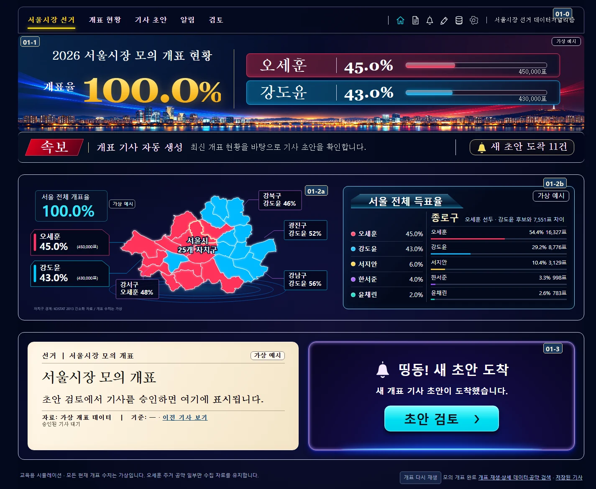
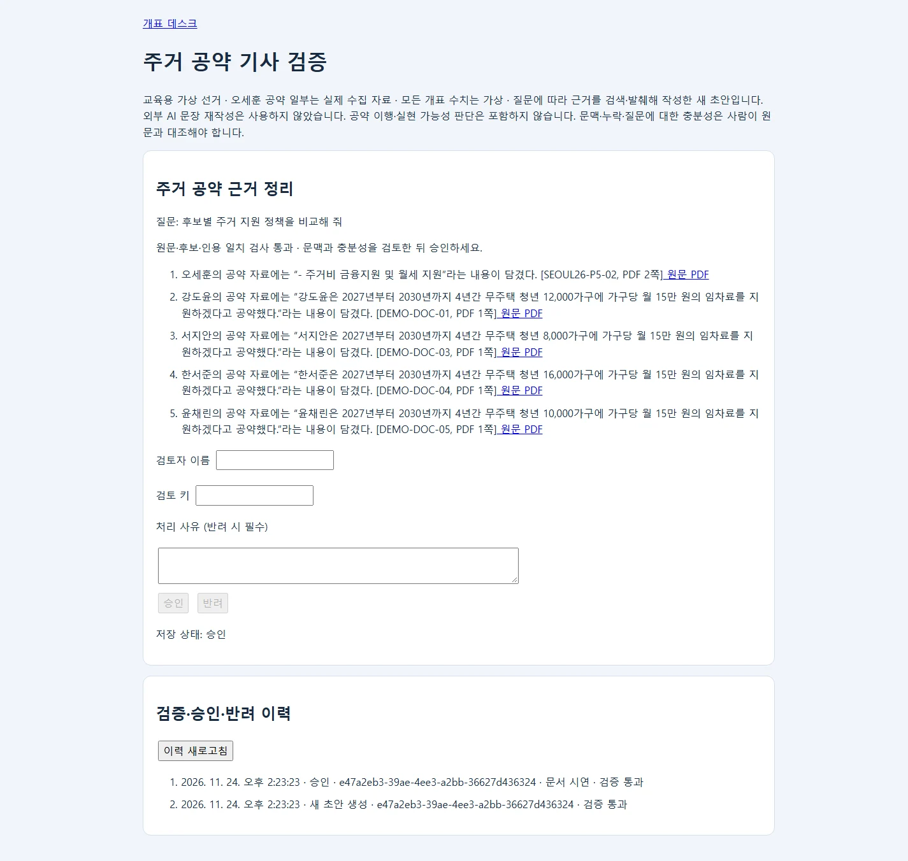
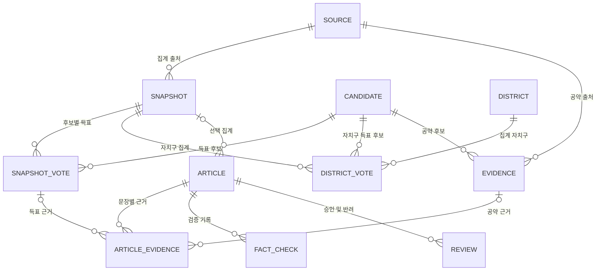
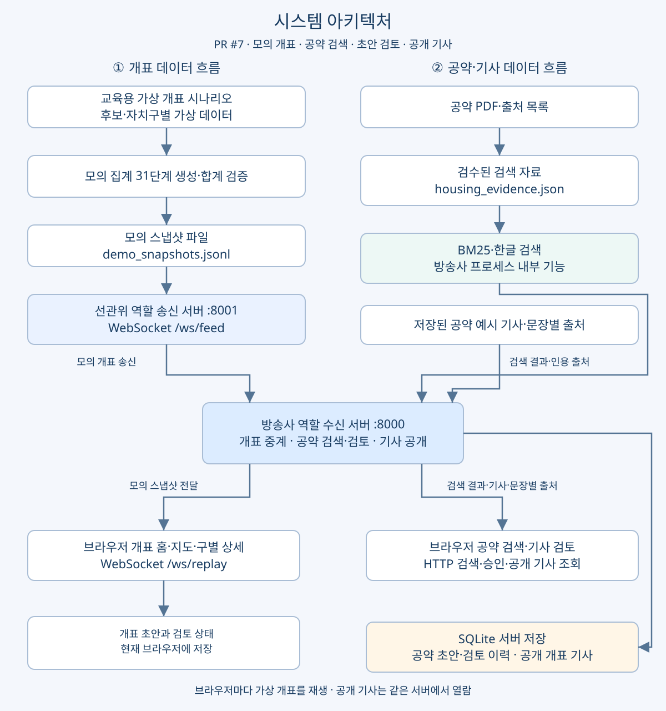

# 서울시장 모의 개표와 공약 기사 시연

[영상 기준 후보자 명단·정당·사진](docs/broadcast-roster/README.md)

서울시장 선거 방송을 가정해 **개표 수치가 바뀌고 → 화면이 갱신되고 → 기사 초안이 만들어지고 → 사람이 검토한 뒤 공개되는 과정**을 보여주는 교육용 프로젝트입니다. 현재 개표 수치·순위·당선 결과는 모두 가상입니다. 오세훈 후보의 주거 공약 일부는 기존 수집 자료를 쓰고, 나머지 공약은 교육용 가상 자료를 사용합니다.

구현 기준은 [PR #7](https://github.com/BTS-Trio/2026-Mayor-of-Seoul/pull/7)입니다. 화면 이미지는 이 브랜치를 로컬 서버에서 실행하고 Chrome에서 직접 캡처했습니다.

> [모의 개표방송 후보자 명단·가상 정당·사진](docs/broadcast-roster/README.md)은 방송 영상의 표기 기준입니다. 기존 공식 집계 재생 자료는 실제 선거 자료의 표기를 따릅니다.

## 목차

- [1. 기획서](#1-기획서)
- [2. 요구사항 정의서](#2-요구사항-정의서)
- [3. WBS](#3-wbs)
- [4. 화면 설계서](#4-화면-설계서)
- [5. ERD](#5-erd)
- [6. API 명세서](#6-api-명세서)
- [7. 시스템 아키텍처](#7-시스템-아키텍처)
- [8. 구현 결과](#8-구현-결과)
- [9. 테스트 결과서](#9-테스트-결과서)
- [10. 사용자 매뉴얼](#10-사용자-매뉴얼)

## 1. 기획서

### 프로젝트 목적·배경·목표

| 항목 | 설명 |
| --- | --- |
| 목적 | 개표 방송 화면과 기사 편집 화면을 한 프로젝트에서 시연합니다. |
| 배경 | 개표 수치가 바뀌어도 시청자는 현재 상황을 쉽게 이해해야 하고, 기사를 쓰는 사람은 숫자와 출처를 다시 확인할 수 있어야 합니다. |
| 목표 | 가상 데이터를 재생하는 동안 개표 현황을 보여주고, 기사 초안을 만들고, 검토자가 승인한 기사를 독자가 읽을 수 있게 합니다. |
| 대상 | 시연을 보는 사람, 개표·공약 기사를 검토하는 팀원, 프로젝트를 실행하는 발표자 |
| 데이터 범위 | 서울 25개 자치구, 개표 31단계, 후보 6명 중 집계 5명과 사퇴 1명, 주거 공약 자료 |
| 시연 범위 | 로컬에서 실행하는 교육용 서비스입니다. 실제 개표 수집, 당선 예측, 팀원 권한 관리, 운영 배포는 이번 구현 범위 밖입니다. |

### 기능 정의 요약

| 기능 | 할 수 있는 일 |
| --- | --- |
| 모의 개표 보기 | 전체 개표율, 상위 후보, 자치구별 선두와 선택한 구의 후보별 득표율을 봅니다. |
| 개표 기사 만들기 | 집계가 특정 시점에 도달하면 근거가 붙은 초안이 생기고 속보 옆에 건수가 뜹니다. |
| 초안 검토 | 숫자와 출처를 확인한 다음 승인하거나 반려합니다. |
| 공약 검색·기사 작성 | 주거 공약을 질문으로 검색하고 PDF 근거가 붙은 기사 초안을 만듭니다. |
| 기사 모아보기 | 승인된 모의 개표·후속·공약 기사를 카드에서 골라 읽습니다. |

## 2. 요구사항 정의서

### 기능 그룹과 번호 연결

`G`는 기능 그룹, `FR`은 기능 요구사항, `NFR`은 공통 품질 기준, `UI`는 화면, `DB`는 데이터 표 번호입니다. 예를 들어 **FR-10 자치구 지도 → UI-01의 01-2a → DB-10·DB-11** 순으로 찾아볼 수 있습니다. 이전 README의 FR-01–FR-09, UI-01–UI-05, DB-01–DB-09 번호를 유지하고 새 기능과 표에 번호를 추가했습니다.

| 기능 그룹 | 주요 기능 | 요구사항 num | 화면 num | DB num |
| --- | --- | --- | --- | --- |
| G-01 개표 현황 | 모의 재생·개표율·자치구 지도·구별 득표 상세·연결 안내 | FR-01–FR-03, FR-10–FR-11 | UI-01, UI-04(예시) | DB-01–DB-03, DB-10–DB-11 |
| G-02 공약·근거 검색 | 질문·후보 검색, PDF 원문 확인 | FR-04–FR-05 | UI-02, UI-03 | DB-01, DB-04–DB-05 |
| G-03 기사 작성·출처 | 공약 초안과 개표 초안 생성, 문장별 출처, 새 초안 알림 | FR-06, FR-09, FR-12–FR-13 | UI-01–UI-03, UI-06 | DB-02–DB-07, DB-12. 개표 초안은 브라우저 저장 |
| G-04 검증·승인·이력 | 오류 차단, 승인·반려, 이력 및 공개 기사 조회 | FR-07–FR-08, FR-14–FR-16 | UI-04(예시), UI-05–UI-07 | DB-02–DB-09, DB-12–DB-14. 개표 검토 상태는 브라우저 저장 |

**DB num은 README에서 표를 찾기 위한 번호입니다.** 실제 데이터에 들어가는 값은 `candidate_id`, `event_id`, `row_id` 같은 ID입니다. 예를 들어 `DB-02`는 집계 표를 뜻하고, `DEMO-SNAPSHOT-030`은 그 표에서 30번 집계를 찾는 값입니다. 개표 화면은 JSONL에 담긴 집계를 받아 표시합니다. 아래 DB 연결은 같은 데이터가 어느 표에 속하는지 보여 줍니다.

### 기능 요구사항과 확인 기준

| ID | 기능 | 언제·어떻게 동작하나요? | 완료 확인 기준 | 관련 화면 num | 관련 DB num |
| --- | --- | --- | --- | --- | --- |
| FR-01 | 모의 개표 재생 | 홈페이지에 접속하면 방송 서버가 WebSocket을 연결합니다. 송신 서버가 0번부터 30번까지 집계 데이터를 순서대로 보냅니다. **개표 다시 재생**을 누르면 처음부터 시작합니다. | 첫 집계부터 100%까지 진행하고 최종 집계가 오면 연결이 정상 종료됩니다. | UI-01(01-1), UI-04(04-1) | DB-02, DB-03 |
| FR-02 | 상단 개표 현황 | 새 집계가 도착할 때마다 전체 개표율, 득표순 상위 두 후보, 득표율, 득표수, 게이지를 함께 바꿉니다. | 후보 순위가 바뀌면 카드 순서도 바뀌고 숫자는 같은 집계와 일치합니다. | UI-01(01-1, 01-2b) | DB-01–DB-03 |
| FR-03 | 데이터 연결 오류 | 송신 서버가 멈추거나 집계가 순서대로 오지 않으면 방송 서버가 오류를 보냅니다. | 화면에서 연결 실패를 확인하고, 송신 서버를 복구한 뒤 **개표 다시 재생**으로 복구할 수 있습니다. | UI-01(01-1) | 해당 없음 · 통신 상태 |
| FR-04 | 주거 공약 검색 | 질문이나 후보로 근거를 검색합니다. 사퇴 후보 포함 여부를 선택하며 결과에서 문서 ID, PDF 쪽수, 인용 근거를 확인합니다. | 관련 근거가 없으면 결과 부족을 안내합니다. 사퇴 후보는 기본 설정에서 제외됩니다. | UI-02(02-1, 02-2) | DB-01, DB-04, DB-05 |
| FR-05 | 원문 근거 확인 | 검색 결과에서 문서 ID, PDF 쪽수, 발췌와 원문 링크를 보여 줍니다. | 표시된 쪽의 원문을 열어 발췌 내용을 확인할 수 있습니다. | UI-02(02-3), UI-03(03-3) | DB-04, DB-05 |
| FR-06 | 기사 문장별 출처 | 공약 기사 문장과 그 문장이 인용한 자료를 함께 보여 줍니다. | 저장한 기사를 다시 열어도 문장별 근거를 볼 수 있습니다. | UI-03(03-1–03-3) | DB-04–DB-07, DB-12 |
| FR-07 | 공약 초안 검토 | 후보·수치·출처·쪽수와 질문에 필요한 비교 범위를 확인합니다. 근거가 빠지거나 다른 내용을 인용한 경우 승인을 막습니다. | 승인·반려 결과와 검토 이력을 서버에서 다시 조회할 수 있습니다. 승인된 공약 기사는 공개 목록에 표시됩니다. | UI-05(05-1, 05-2) | DB-04–DB-08 |
| FR-08 | 공약 기사 승인·반려 이력 | 검토 결과와 처리자, 반려 사유를 저장합니다. | 새로고침 후 이력을 다시 보고 승인된 공약을 공개 목록에서 읽을 수 있습니다. | UI-05(05-2, 05-3), UI-07 | DB-06, DB-09, DB-12, DB-13 |
| FR-09 | 공약 초안 생성·저장 | 질문에 관련된 공약 원문을 골라 초안과 문장별 출처를 구성합니다. 검색한 원문을 활용하는 방식으로 별도 AI API 키가 필요하지 않습니다. | 질문이 바뀌면 선택 근거도 바뀝니다. 초안은 새로고침 후 저장 목록에서 다시 열 수 있습니다. | UI-02(02-4), UI-03(03-1, 03-2) | DB-04–DB-07, DB-12 |
| FR-10 | 서울 자치구 지도 | 각 구에서 득표수가 가장 많은 후보의 색으로 구를 표시합니다. 집계 전이나 공동 선두인 경우 구의 선두 색을 정하지 않습니다. 구를 선택하면 구 이름과 집계 정보가 표시됩니다. | 25개 구가 표시되고, 마우스나 키보드로 구를 선택할 수 있습니다. | UI-01(01-2a) | DB-01–DB-03, DB-10, DB-11 |
| FR-11 | 서울 전체와 구별 득표 상세 | 서울 전체 후보 5명의 득표율 옆에 선택한 구의 후보별 득표수·득표율을 함께 보여 줍니다. | 구를 바꿔도 왼쪽 서울 전체 목록은 같은 집계를 유지하고, 오른쪽은 선택한 구의 집계로 바뀝니다. | UI-01(01-2b) | DB-01–DB-03, DB-10–DB-11 |
| FR-12 | 자동 초안 생성 | 개표율 **10%, 20%, …, 90%**를 처음 넘거나 도달할 때, 선두가 바뀔 때, 최종 집계가 도착할 때 초안을 만듭니다. 100%는 최종 집계 기사로 처리합니다. | 이 시나리오에서 10% 단위 9건, 선두 변경 1건, 최종 집계 1건이 생성됩니다. 같은 집계·생성 이유를 재생해도 초안이 중복되지 않습니다. | UI-01(01-3), UI-06(06-1) | DB-02, DB-03 · 초안은 브라우저 |
| FR-13 | 알림과 출처 | 새 초안 건수를 **속보** 옆에 표시합니다. 초안에는 가상 집계 시각, 후보 득표수, 집계 행 ID와 후보 행 ID를 표시합니다. | 새 초안이 생기면 건수가 늘고, 상단 알림이나 하단 **초안 검토**에서 검토 화면을 열 수 있습니다. | UI-01(01-3), UI-06(06-1) | DB-02, DB-03 · 알림은 브라우저 |
| FR-14 | 개표 기사 검증 | 기사와 원래 집계의 득표수를 비교합니다. 오류 시연을 위해 기사 숫자에 100표를 더하면 승인을 막습니다. | 오류 스위치를 켜면 승인 버튼이 잠기고, 끄면 다시 승인할 수 있습니다. | UI-06(06-2) | DB-02, DB-03 |
| FR-15 | 개표 기사 승인·반려 | 승인하면 홈 왼쪽 기사가 최신 승인 기사로 바뀝니다. 서버 실행 중에는 승인 기사가 공개 목록에도 들어갑니다. 반려는 사유를 입력해야 합니다. | 반려 기사는 공개 목록에서 제외되고, 앞서 승인한 기사는 새 기사로 교체된 뒤에도 목록에서 열립니다. | UI-06(06-2), UI-01(01-3), UI-07 | DB-02, DB-03, DB-14 · 검토 상태는 브라우저 |
| FR-16 | 기사 모아보기 | 모의 개표·후속·공약 분류를 선택하면 해당 기사 카드가 보입니다. 카드를 누르면 본문이 작은 창으로 열리고 주소에 기사 ID가 들어갑니다. | 같은 서버 주소에 접속하는 다른 브라우저에서 공유 주소로 승인 기사를 읽을 수 있습니다. | UI-07(07-1, 07-2) | DB-06, DB-14 |

### 데이터·화면 품질 요구사항

| ID | 기준 | 확인 방법 | 관련 화면 num | 관련 DB num |
| --- | --- | --- | --- | --- |
| NFR-01 | 실제·모의 데이터 구분 | 개표·기사 화면에서 모의 개표 표시와 가상 집계 시각을 확인합니다. | UI-01, UI-04, UI-06, UI-07 | DB-02, DB-03, DB-14 |
| NFR-02 | 출처·사퇴 상태 보존 | 자료 ID, PDF 쪽수와 사퇴 근거를 원문과 대조합니다. | UI-02, UI-03 | DB-01, DB-04, DB-05, DB-07 |
| NFR-03 | 같은 환경에서 다시 실행 | 사용자 매뉴얼대로 두 서버를 실행해 같은 집계를 재생합니다. | 사용자 매뉴얼 | 해당 없음 |
| NFR-04 | 사람의 검토와 보도 책임 | 출처와 숫자를 대조하고 승인한 뒤 공개합니다. 예시 화면과 공개 화면을 구분합니다. | UI-03–UI-07 | DB-06–DB-09, DB-14 |
| NFR-05 | 공개·저장 위치 구분 | 다른 브라우저에서 승인 기사만 보이는지 확인합니다. 개표 초안과 검토 상태는 브라우저, 공개 개표·공약 기사와 공약 검토 이력은 서버에 저장됩니다. | UI-05–UI-07 | DB-06, DB-09, DB-12–DB-14 |
| NFR-06 | 모바일 기사 열람 | 좁은 화면에서 카드와 기사 본문 창이 넘치지 않는지 확인합니다. | UI-07 | 해당 없음 |

## 3. WBS

WBS는 일을 작은 단위로 나눠 담당과 순서를 정리한 표입니다. 아래 이름과 날짜는 기존 팀 계획 기준이며, 날짜는 계획 일정입니다. 완료 여부는 코드와 검증 결과로 구분했습니다. [기존 작업 계획](demo/docs/project-plan.md)

| 순서 | 작업 | 담당 | 선행 작업 | 계획 일정 | 산출물·상태 |
| --- | --- | --- | --- | --- | --- |
| 1 | 주제와 보도 범위 정하기 | 공동 | — | 11/20 | 기획·요구사항 정리 |
| 2 | 후보·공약 자료 정리 | 윤 | 1 | 11/20–23 | 후보 자료, PDF와 출처 목록 구현 |
| 3 | 가상 개표 데이터 만들고 대조 | 윤 | 2 | 11/23 | CSV·JSONL과 합계 검사 구현 |
| 4 | 화면과 메뉴 설계 | 흠 | 1 | 11/20–23 | 홈·검토·공개 기사 화면 구현 |
| 5 | DB와 서버 연결 설계 | 태 | 3, 4 | 11/20–23 | ERD·API·두 서버 구조 구현 |
| 6 | 송신·수신 서버와 개표 화면 연결 | 태·흠 | 5 | 11/23–24 | 지도·구별 상세와 재생 시연 확인 |
| 7 | 공약 검색과 기사 근거 연결 | 윤 | 2 | 11/23–25 | 검색·초안 생성·PDF 인용 구현 |
| 8 | 기사 검토·승인·반려 연결 | 태·흠 | 6, 7 | 11/24–25 | 검토 화면·저장·공개 목록 구현 |
| 9 | 화면과 데이터 교차 검수 | 공동 | 7, 8 | 11/25–26 | 핵심 흐름 검증, 팀 최종 교차 검수 일정 별도 |
| 10 | 10분 방송 영상·대본·자막 준비 | 흠 중심·공동 검수 | 7, 9 | 11/24–26 | 영상 작업 계획, 이 PR에서 완료 여부 미확인 |
| 11 | 통합 발표·제출 | 공동 | 6–10 | 11/26–27 | README·실행 화면 제공, 최종 제출 별도 |

### 대시보드 수정 담당

| 영역 | 담당 | 변경 내용 |
| --- | --- | --- |
| 가운데 자치구 지도·득표율 | 윤 | 지도 선택과 자치구 상세 연결, 서울 전체 후보 5명 득표율 유지, 개표율 위치·줄 정렬·글꼴 정리 |
| 상단 개표 화면 | 태 | 화면 수정 중 |
| 하단 모의 개표 기사 | 태 | 기사 영역 수정 중 |

## 4. 화면 설계서

실제로 실행한 화면에 번호를 붙여 화면 설계와 실행 예시를 함께 보여 줍니다. 이미지의 영역 번호는 아래 연결표에서 찾을 수 있습니다.

### UI-01 · 모의 개표 홈



### UI-06 · 개표 기사 초안 검토


### UI-07 · 기사 모아보기


<details>
<summary>기사 본문 창 보기</summary>


</details>

### UI-02 · 공약 검색


### UI-03·UI-05 · 공약 기사와 검토



<details>
<summary>UI-04 · 오프라인 예시 화면 설계안 보기</summary>


</details>

<details>
<summary>화면·요구사항·DB 번호 연결표 보기</summary>

| 화면 num | 화면 | 주소 | 하는 일 |
| --- | --- | --- | --- |
| UI-01 | 모의 개표 홈·상세 | `/`, `/offline-preview.html` | 개표율·지도·구별 득표 상세·알림 확인. 상세 화면에서 개표 단위와 후보별 표 조회 |
| UI-02 | 주거 공약 검색 | `/housing-search` | 질문·후보로 검색하고 초안 생성 |
| UI-03 | 공약 기사·문장별 출처 | `/housing-search`, `/housing-review`의 기사 영역 | 저장 기사 본문과 문장별 PDF 근거 확인 |
| UI-04 | 오프라인 개표 검토 예시 | `Seoul-Election-Desk.html` 또는 `demo/offline-preview.html` 파일 | 예시 기사 작성·오류 차단·승인·반려 시연 |
| UI-05 | 공약 기사 검토 | `/housing-review` | 서버 검증, 승인·반려, 저장 이력 조회 |
| UI-06 | 개표 기사 검토 | `/vote-review.html` | 자동 생성 초안 선택, 숫자 대조, 승인·공개 또는 반려 |
| UI-07 | 기사 모아보기 | `/articles` | 승인 기사 분류·열람, 기사 주소 공유 |

### 화면 안의 영역 num

| 영역 num | 실제 화면에서 찾는 곳 | 관련 요구사항 num | 관련 DB num |
| --- | --- | --- | --- |
| 01-0 | 홈 상단 제목·모의 안내 | NFR-01, NFR-04 | 없음 |
| 01-1 | 홈 개표율·다시 재생·연결 상태 | FR-01–FR-03 | DB-02, DB-03. 연결 오류는 통신 상태 |
| 01-2a | 홈 가운데 자치구 지도 | FR-10 | DB-01–DB-03, DB-10–DB-11 |
| 01-2b | 홈의 서울 전체 후보 목록·구별 득표 상세 | FR-02, FR-11 | DB-01–DB-03, DB-10–DB-11 |
| 01-3 | 홈 속보 옆 알림, 승인 기사, 초안 검토·공약 검색 이동 | FR-04, FR-12–FR-13, FR-15 | DB-02–DB-05, DB-14. 알림은 브라우저 |
| 01-4 | 상세 화면 하단 역대 선거 비교 | 참고 표시 | 별도 역대 비교 표 없음 |
| 02-1 / 02-2 | 공약 검색 조건 입력 / 후보별 근거 결과 | FR-04 | DB-01, DB-04–DB-05 |
| 02-3 / 02-4 | PDF 원문 확인 / 질문으로 초안 만들기 | FR-05, FR-09 | DB-04–DB-07, DB-12 |
| 03-1 / 03-2 / 03-3 | 공약 기사 본문 / 문장별 인용 / 원문 대조 | FR-05–FR-06, FR-09 | DB-04–DB-07, DB-12 |
| 04-1 / 04-2 / 04-3 | 오프라인 예시 본문 / 검증·처리 / 결과 표시 | FR-01–FR-02, FR-06–FR-08 시연 | DB-02–DB-03 데이터와 대응. 서버 검토 기록 없음 |
| 05-1 / 05-2 / 05-3 | 공약 기사 검증 / 승인·반려 / 기록 조회 | FR-07–FR-08 | DB-04–DB-09, DB-12–DB-13 |
| 06-1 / 06-2 | 개표 초안 선택·근거 / 숫자 검증·승인·반려 | FR-12–FR-15 | DB-02–DB-03, DB-14. 초안·검토 상태는 브라우저 |
| 07-1 / 07-2 | 공개 기사 분류·카드 / 본문·공유 주소 | FR-16 | DB-06, DB-14 |

</details>

## 5. ERD

ERD는 데이터 표 사이의 관계를 그린 그림입니다. 예를 들어 집계 한 건은 여러 후보의 득표 행을 갖고, 기사의 한 문장은 공약 근거나 득표 행 하나를 가리킵니다.



| DB num | 실제 표 이름 | ID·주요 데이터 | 원본 및 저장 위치 |
| --- | --- | --- | --- |
| DB-01 | CANDIDATE | `candidate_id`(PK), 이름, 정당, 출마·사퇴 상태 | [후보 CSV](demo/data/tables/CANDIDATE.csv), [후보 JSON](demo/data/candidates.json) |
| DB-02 | SNAPSHOT | `event_id`(PK), 순서, 가상 시각, 투표지 수, 개표율, `source_id`(FK) | [집계 CSV](demo/data/tables/SNAPSHOT.csv), [송신용 JSONL](demo/data/demo_snapshots.jsonl) |
| DB-03 | SNAPSHOT_VOTE | `row_id`(PK), `event_id`·`candidate_id`(FK), 득표수·득표율 | [후보별 집계 CSV](demo/data/tables/SNAPSHOT_VOTE.csv), JSONL의 `candidates` |
| DB-04 | SOURCE | `source_id`(PK), 자료 제공처, 제목, URL, 파일 경로, PDF 총 쪽수 | [출처 CSV](demo/data/tables/SOURCE.csv), 공약 JSON의 `documents`와 후보 상태 출처 |
| DB-05 | EVIDENCE | `chunk_id`(PK), `source_id`·`candidate_id`(FK), `document_id`, PDF 쪽수, 인용 원문 | [근거 CSV](demo/data/tables/EVIDENCE.csv), [공약 근거 JSON](demo/data/rag/housing_evidence.json)의 `chunks` |
| DB-06 | ARTICLE | `article_id`(PK), 선택 `snapshot_id`(FK), 제목·본문·상태 | [예시 기사 CSV](demo/data/tables/ARTICLE.csv), 공약 초안을 서버에 저장할 때 추가 |
| DB-07 | ARTICLE_EVIDENCE | `id`(PK), `article_id`(FK), 문장 번호·ID, `chunk_id` 또는 `row_id`(FK) | [문장별 근거 CSV](demo/data/tables/ARTICLE_EVIDENCE.csv), 공약 기사 저장 시 추가 |
| DB-08 | FACT_CHECK | `check_id`(PK), `article_id`(FK), 검사 결과·이유·시각 | [초기 CSV](demo/data/tables/FACT_CHECK.csv)는 0건, 서버 검증 시 저장 |
| DB-09 | REVIEW | `review_id`(PK), `article_id`(FK), 승인·반려·검토자·사유·시각 | [초기 CSV](demo/data/tables/REVIEW.csv)는 0건, 서버 공약 검토 시 저장 |
| DB-10 | DISTRICT | `district_id`(PK), 자치구 이름 | [자치구 CSV](demo/data/tables/DISTRICT.csv) |
| DB-11 | DISTRICT_VOTE | `event_id`·`district_id`·`candidate_id`(세 값을 함께 PK로 사용하며 각각 FK), 득표수 | [자치구 득표 CSV](demo/data/tables/DISTRICT_VOTE.csv), JSONL의 `districts` |
| DB-12 | drafts | `id`(PK), 공약 초안 원본과 상태 | [공약 검토 서버](demo/housing_review.py)가 SQLite에 저장 |
| DB-13 | audit | `seq`(PK), `draft_id`, 작업 유형, 검토자, 사유, 검사 결과, 시각 | [공약 검토 서버](demo/housing_review.py)가 SQLite에 기록 |
| DB-14 | published_vote_articles | `id`(PK), 공개 개표 기사 내용, 공개 시각 | [기사 공개 서버](demo/article_archive.py)가 검증한 승인 기사를 SQLite에 저장 |

### ID를 따라 데이터 찾기

| 알고 있는 값 | 찾아가는 순서 |
| --- | --- |
| 집계 ID `DEMO-SNAPSHOT-030` | DB-02의 `event_id`로 최종 집계를 찾고 → 같은 값으로 DB-03의 후보별 득표와 DB-11의 구별 득표를 찾습니다. |
| 후보 ID `DEMO-C02` | DB-01에서 후보를 찾고 → DB-03의 득표 행, DB-05의 공약 근거, DB-11의 자치구 득표를 같은 후보 ID로 연결합니다. |
| PDF 자료 ID와 쪽수 | DB-05의 `document_id`·`pdf_page`로 해당 발췌를 찾고 → `source_id`로 DB-04에서 자료 경로를 확인합니다. |
| 공약 기사 ID | DB-06에서 제목과 본문을 찾고 → DB-07에서 문장별 근거, DB-08·09에서 검사와 승인·반려를 봅니다. 실행 중 공약 초안과 이벤트 원본은 DB-12·13에서 확인합니다. |
| 공개 개표 기사 ID `feed:DEMO-SNAPSHOT-030:최종 집계` | DB-14에서 공개 본문을 찾습니다. 본문에 포함된 집계 ID와 후보 행 ID는 각각 DB-02와 DB-03에서 대조할 수 있습니다. |

기본 키(PK)는 표에서 한 행을 구분하는 ID이고, 외래 키(FK)는 다른 표의 ID를 참조하는 값입니다. `drafts`, `audit`, `published_vote_articles`는 실행 시 별도로 생성됩니다. 개표 초안의 선택·검토 상태는 브라우저 저장소에 남으며, 위 공개 기사 표에는 승인되어 공개한 본문이 들어갑니다. [SQL 정의](demo/schema.sql) · [데이터 적재 코드](demo/table_data.py)

## 6. API 명세서

API는 화면과 서버가 데이터를 주고받는 약속입니다. `GET`은 조회, `POST`는 새로 만들거나 처리할 때 사용합니다. WebSocket은 서버가 연결을 유지하면서 다음 개표 집계를 바로 보내는 방식입니다.

| 연결 | 주소 | 보내는 값 | 받는 값 또는 실패 처리 |
| --- | --- | --- | --- |
| WebSocket | 송신 서버 `/ws/feed` | 연결 요청 | 0–30번 집계와 `source_sent_at`. 마지막 집계 후 종료 |
| WebSocket | 방송 서버 `/ws/replay` | 연결 요청 | 같은 집계에 `delivered_at` 추가. 송신 끊김 또는 순서 오류 시 `election_feed_unavailable` 오류 |
| GET | 두 서버 `/health` | — | 서버 역할과 가상 데이터 모드 확인 |
| GET | `/api/candidates`, `/api/final` | — | 후보 목록과 모의 개표 최종 집계 |
| GET | `/api/housing/status` | — | 공약 검색 자료 상태 |
| GET | `/api/housing/search` | `q`, `candidate`, `limit`, `include_withdrawn` | 공약 근거 검색 결과와 후보 범위. 잘못된 검색 조건은 400 |
| GET | `/api/housing/draft` | — | 저장된 예시 기사와 문장별 출처. 근거 데이터 연결 실패 시 503 |
| GET | `/sources/{filename}` | 파일명 | 허용된 근거 PDF. 등록되지 않은 파일은 404 |
| POST | `/api/housing/generate` | `question`, 선택적으로 `candidate`, `include_withdrawn` | 201과 저장된 공약 초안·검증 결과. 근거가 부족하면 422 |
| POST | `/api/housing-review/drafts` | `scenario` | 검증 시연용 예시 초안 생성 |
| GET | `/api/housing-review/drafts`, `/api/housing-review/drafts/{draft_id}` | 목록 또는 초안 ID | 저장된 초안 목록 또는 본문·검증 결과 |
| POST | `/api/housing-review/drafts/{draft_id}/decision` | `action`의 값은 `approve` 또는 `reject`, 그 외 `reviewer`, 반려 시 `reason` | 승인·반려 저장. 사유 부족은 422, 이미 처리됐거나 승인할 수 없으면 409 |
| GET | `/api/housing-review/history` | — | 공약 기사 검토 기록 |
| POST | `/api/articles/vote` | `event_id`, `reason`, `votes` | 근거와 대조해 승인 개표 기사 저장. 불일치 시 422 |
| GET | `/api/articles` | — | 공개된 개표·후속 기사 `vote`와 공약 기사 `housing` 목록 |

집계 메시지의 `sequence`는 순서 번호, `simulated_at`은 가상 집계 시각, `count_progress_pct`는 개표율입니다. `candidates`에 후보별 득표가, `districts`에 자치구별 득표가 들어갑니다. `complete`가 참이면 최종 집계입니다. 실행 중인 방송 서버의 [API 화면](http://127.0.0.1:8000/docs)에서도 HTTP 요청과 입력 항목을 확인할 수 있습니다. [데이터·API 참고 문서](demo/docs/data-and-api.md)

### 예시 요청과 응답

공개 조회는 검토 키 없이 이용할 수 있습니다. 개표 기사 공개와 공약 기사 승인·반려 요청에는 서버에 설정한 검토 키를 `X-Reviewer-Key` 헤더로 보내야 합니다. 키가 틀리거나 빠지면 403, 서버에 키를 설정하지 않으면 503을 반환합니다.

최종 개표 기사를 승인하면 화면은 아래 데이터를 `POST /api/articles/vote`로 보냅니다.

```json
{"event_id":"DEMO-SNAPSHOT-030","reason":"최종 집계","votes":450000}
```

서버는 30번 집계의 선두 득표수가 450,000표인지 확인합니다. 맞으면 `200`과 함께 기사 ID를 돌려줍니다. 예를 들어 450,100표를 보내면 `422`가 오고 기사는 저장되지 않습니다.

```json
{"id":"feed:DEMO-SNAPSHOT-030:최종 집계"}
```

## 7. 시스템 아키텍처

아키텍처는 전체 서비스가 어떤 프로그램으로 나뉘고 서로 어떻게 연결되는지 보여줍니다.



[구성도 크게 보기](docs/images/system-architecture.svg)

송신 서버는 저장된 집계를 순서대로 보내고, 방송 서버는 연결 상태를 점검해 화면에 전달합니다. 개표 초안은 화면에서 집계 내용으로 생성됩니다. 공개 요청이 오면 방송 서버가 원본 집계의 득표수와 다시 대조합니다. 공약 초안의 검색·생성·검증은 방송 서버가 처리합니다.

## 8. 구현 결과

### 소스코드

| 파일 | 역할 |
| --- | --- |
| [election_source.py](demo/election_source.py) | 개표 JSONL을 차례로 송신 |
| [app.py](demo/app.py) | 화면·HTTP API 제공, 모의 집계 연결과 전달 |
| [index.html](demo/index.html) · [dashboard-feed.js](demo/dashboard-feed.js) | 홈, 지도·구별 득표 상세, 개표 재생과 초안 생성 시점 |
| [vote-drafts.js](demo/vote-drafts.js) · [vote-review.html](demo/vote-review.html) | 개표 초안 저장, 확인, 승인·반려 |
| [housing_search.py](demo/housing_search.py) · [article_generation.py](demo/article_generation.py) | 주거 공약 원문 검색과 문장별 근거가 붙은 기사 구성 |
| [housing_review.py](demo/housing_review.py) · [article_validation.py](demo/article_validation.py) | 공약 기사 검증과 서버 저장, 승인·반려 이력 |
| [articles.html](demo/articles.html) · [article_archive.py](demo/article_archive.py) | 공개 기사 카드·본문과 조회·저장 API |

### DB 스크립트와 데이터

- [schema.sql](demo/schema.sql)의 `CREATE TABLE` 구문이 표와 연결 규칙을 만듭니다.
- [table_data.py](demo/table_data.py)가 [CSV 초기 데이터](demo/data/tables/manifest.json)를 순서대로 읽고 `INSERT INTO`로 넣습니다. 서버는 첫 저장 작업에서 초기화하며 이미 적재된 후보가 있으면 초기 데이터를 다시 넣지 않습니다.
- 검토 이력과 공개 기사 표는 서버 요청으로 채웁니다. 승인·반려 기록을 초기 데이터로 미리 만들어 넣지 않습니다.
- 데이터 적재만 확인하려면 `demo` 폴더에서 `python table_data.py`를 실행합니다. 메모리 DB에 적재하고 표별 행 수를 출력합니다. 기본 서버 DB 경로는 `demo/housing-review-demo-v2.sqlite3`이며 `HOUSING_REVIEW_DB`로 바꿀 수 있습니다.

### GitHub 저장소와 협업 기록

조직 저장소는 [BTS-Trio/2026-Mayor-of-Seoul](https://github.com/BTS-Trio/2026-Mayor-of-Seoul)입니다. [PR #7](https://github.com/BTS-Trio/2026-Mayor-of-Seoul/pull/7)에서 `feat/yun-dummy-data-integration` 브랜치 변경과 리뷰 기록을 확인할 수 있습니다. PR의 **Commits**는 작업 순서, **Files changed**는 실제로 바뀐 파일, **Checks**는 자동 검사 상태를 보여줍니다.

## 9. 테스트 결과서

Windows에서 Python 자동 검사와 Chrome 실행 검사를 진행했습니다. Python 자동 검사는 **26건 통과**했으며, Chrome 화면은 아래 주요 흐름을 확인했습니다. [기존 검증 기록](demo/docs/test-results.md)

| 확인 항목 | 검증 방법과 결과 |
| --- | --- |
| 데이터와 DB | 31개 집계에서 서울 전체와 구별 득표 합계 일치, 후보·문서·PDF 참조와 DB 연결 확인 |
| 서버 연결 | WebSocket으로 31개 집계 수신, 마지막 개표율 100%, 송신 서버 중단 시 오류 응답 확인 |
| 지도와 구별 상세 | Chrome에서 25개 자치구에 각각 해당하는 득표 상세와 서울 전체 후보 목록 확인 |
| 자동 초안과 알림 | Chrome에서 10% 단위 9건·선두 변경 1건·최종 집계 1건, 속보 옆 알림 확인 |
| 개표 초안 검토 | 오류 숫자 승인 차단, 반려 사유 필수, 승인 뒤 홈 기사 갱신 확인 |
| 공약 검색·검토 | 근거가 없는 질문 처리, 사퇴 후보 선택, 초안 저장 후 재조회와 승인·반려 확인 |
| 공개 기사 | 미승인 공약 기사 제외, 검토 키 누락·오류 시 처리 차단, 틀린 득표수 차단, 중복 저장 방지 확인 |
| 기사 페이지 | 브라우저 데이터 없이 서버 공개 기사 열람, 이전 기사 목록에서 개표 기사와 후속기사 함께 조회, 본문 열기·닫기, 375px 모바일 배치 확인 |

### 오류 수정 기록

| 발견한 문제 | 수정한 방식 |
| --- | --- |
| 새 홈을 적용한 뒤 개표 기사와 지도·그래프가 내장 예시를 보던 상태 | 홈을 개표 WebSocket에 연결해 같은 집계에서 화면과 초안을 갱신했습니다. |
| 홈에서 새 기사로 교체되면 예전 기사를 찾기 어려움 | 홈의 **이전 기사 보기**를 독립 기사 페이지에 연결했습니다. |
| 같은 브라우저에서만 개표 기사 열람 가능 | 승인 시 서버에 저장하고, 공개 기사 주소로 다른 브라우저에서 열 수 있게 했습니다. |
| 화면 교체 후 기존 공약 Chrome 테스트 시작 경로 불일치 | 기존 상세 화면 주소에서 공약 검토 테스트를 시작하도록 수정했습니다. |

테스트를 다시 실행하려면 `demo`에서 개발 의존성을 설치한 후 다음을 실행합니다.

```powershell
..\.venv\Scripts\python.exe -m pip install -r requirements-dev.txt
..\.venv\Scripts\python.exe -m unittest -v
..\.venv\Scripts\python.exe check_housing_review_browser.py
```

마지막 명령은 저장소에 있는 공약 검토용 Chrome 검사이며, 스크립트가 사용하는 Windows 기본 경로에 Chrome이 설치되어 있어야 합니다.

## 10. 사용자 매뉴얼

### 처음 한 번 준비하기

저장소에서 PR #7 브랜치를 내려받고 **저장소 최상위 폴더**에서 PowerShell을 엽니다.

```powershell
python -m venv .venv
.\.venv\Scripts\python.exe -m pip install -r demo/requirements.txt
```

### 두 서버 실행하기

터미널 두 개를 같은 저장소 최상위 폴더에서 엽니다.

**터미널 1 · 가상 개표 수치를 보내는 서버**

```powershell
cd demo
..\.venv\Scripts\python.exe -m uvicorn election_source:app --host 127.0.0.1 --port 8001
```

**터미널 2 · 화면을 보여 주는 서버**

기사 검토를 시연하려면 방송 서버를 실행하기 전에 영문·숫자로 된 추측하기 어려운 검토 키를 설정합니다. 승인 화면의 **검토 키**에 같은 값을 입력합니다.

```powershell
cd demo
$env:ELECTION_REVIEW_KEY = [System.Net.NetworkCredential]::new("", (Read-Host "방송 서버 검토 키" -AsSecureString)).Password
..\.venv\Scripts\python.exe -m uvicorn app:app --host 127.0.0.1 --port 8000
```

두 터미널을 유지한 상태로 [개표 대시보드](http://127.0.0.1:8000/)를 엽니다. 기본 재생은 약 60초입니다.

### 모의 개표 기사 시연

1. 홈에서 개표율과 후보 득표율이 변하는지 확인합니다. 지도에서 구를 누르면 오른쪽에 해당 구의 후보별 득표수와 득표율이 표시됩니다.
2. 상단 속보 옆에 **새 초안 도착**이 표시되면 알림이나 하단 **초안 검토**를 누릅니다.
3. 검토할 기사를 선택하고 본문에 적힌 숫자와 집계 근거를 확인합니다.
4. **승인**을 누른 뒤 홈으로 돌아가면 왼쪽 기사 영역이 갱신됩니다. **반려**를 선택했다면 이유를 적습니다.
5. 다른 기사를 승인해 홈에 표시되는 기사를 바꿉니다. **이전 기사 보기**에서 앞서 승인한 기사 카드를 누르면 다시 읽을 수 있습니다.
6. **기사 모아보기**에서 기사 카드를 열고 주소창의 링크를 공유합니다. `127.0.0.1`은 현재 컴퓨터 주소이므로 다른 팀원이 보려면 두 사람이 접속할 수 있는 동일한 시연 서버 주소를 사용해야 합니다.

### 공약 기사 시연

1. 홈의 **기사 초안** 메뉴에서 공약 검색 화면을 엽니다.
2. 예를 들어 **후보별 주거 지원 정책을 비교해 줘**라고 입력합니다.
3. 검색 결과와 PDF 쪽수를 확인하고 초안을 생성합니다. 저장된 초안은 목록에서 다시 열 수 있습니다.
4. 검토 화면에서 근거를 확인하고 승인하거나 반려합니다. 승인된 공약 기사는 **기사 모아보기 → 공약 기사**에서 읽을 수 있습니다.

### 자주 생기는 문제

| 증상 | 확인 방법 |
| --- | --- |
| 홈은 열리는데 개표가 시작되지 않아요. | 터미널 1의 8001 서버가 켜져 있는지 확인하고 홈에서 **개표 다시 재생**을 누릅니다. |
| 기사 모아보기에 카드가 없어요. | 개표가 충분히 진행된 뒤 검토 화면에서 기사를 승인하거나, 공약 기사를 생성한 뒤 승인합니다. |
| 예전에 승인한 개표 기사가 다른 브라우저에서 안 보여요. | 예전 버전에서 브라우저에만 저장했다면 기존 브라우저의 검토 화면에서 기사를 선택하고 **이 승인 기사 공개하기**를 누릅니다. |
| 팀원에게 보낸 링크가 열리지 않아요. | 공유한 URL이 `127.0.0.1`인지 확인합니다. 두 사람 모두 접근할 수 있는 시연 서버가 필요합니다. |
| 서버 실행 없이 먼저 화면을 볼 수 있나요? | `demo/index.html` 또는 `demo/offline-preview.html`을 엽니다. 예시 집계 화면을 볼 수 있습니다. 공약 기사 서버 검토 및 팀원과 공개 기사 공유에는 서버가 필요합니다. |

추가 자료는 [데이터와 PDF 연결 안내](demo/docs/dummy-data-integration.md), [질문 기반 공약 초안 설명](demo/docs/article-generation.md), [시연 실행 안내](demo/README.md)에서 확인할 수 있습니다.
